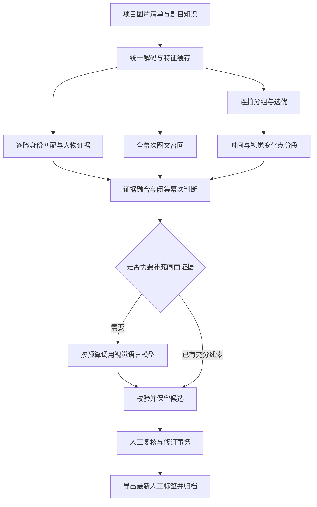

# 核心算法与处理性能升级蓝图

> 制定日期：2026-10-19。实现基线：Git `391ef98`。  
> 本文定义后续 U0–U8 的实施步骤与验收目标；首轮已开始正确性修复及本地模型接入，逐项结果见执行进度。数值门槛是项目目标，不能当作模型实测结果。  
> 当前执行状态见 [升级进度](core_upgrade_progress.md)，既有能力见 [工作台指南](workspace_guide.md)、[智能整理蓝图](smart_organize_blueprint.md) 与 [多模态蓝图](multimodal_context_blueprint.md)。

## 1. 目标与实施原则

目标是提高幕次候选召回、演员匹配与连拍选优质量，同时缩短整批处理时间，使长任务能够恢复、失败能够定位、人工结果能够可靠保留。

按以下顺序推进：修复结果错误 → 建立可信基准 → 接通已有批量能力 → 改善任务与复核存储 → 对比新模型与新分段方法 → 完整工作流验收。每个阶段只改变一个主要因素，并保存基线和候选结果。

- 文件名规则、图像事实、模型推断、人工决定分别记录出处；所有机器场景判断仍进入人工复核。
- 演员身份由人脸匹配提供，角色由剧目演员表关联；视觉语言模型可以观察服饰与动作，不能凭外貌直接确认演员身份。
- 原图、正式人脸库和现有人工标签保留。基准、实验输出及人脸库副本使用独立目录。
- 支持现有 `/organize`、`/ui`、`/legacy` 及其兼容入口。新增接口与字段保持旧调用兼容。
- GPU、模型权重和标注不足时，报告明确标记缺项，不能用假模型或历史结果替代真实效果验收。
- 候选方法可被否决。实验结果不达标时，完成评估并记录原因；生产默认仍使用最近通过验收的方案。

## 2. 现状、缺陷与历史证据

### 2.1 已确认的正确性问题

以下行为已在 2026-10-19 通过不加载真实模型的最小样例复现，不能据此推断真实数据的受影响比例。

| 编号 | 代码位置 | 基线行为及复现 | 修复方向 |
| --- | --- | --- | --- |
| C1 | `scene_split.py::_subcluster` | 段内重新从 0 建索引，却读取全量矩阵；第 8–15 张照片取到第 0–7 行特征 | 保持全局路径与特征映射，排序、分段后按路径读取 |
| C2 | `multimodal_evidence.py::rank` | 先词法 Top-K，再视觉重排；六幕样例中第六幕视觉完全匹配，K=5 时无法召回 | 视觉对全部幕次或独立候选池检索，再融合词法候选 |
| C3 | `smart_organizer.py::_recognize_image` | 一张脸与两个演员的相似度为 1.0、0.8 时，阈值 0.55 会同时输出两人 | 先按身份聚合锚定分数，再逐脸取最佳身份，检查第二名差距 |
| C4 | `review_queue.py::seed` | 旧记录一律保留；未审核的“旧候选”重跑后仍为旧候选 | 仅保留人工锁定记录，更新 pending 候选及其版本 |

修复 C3 前必须区分演员身份 ID 与“演员（饰角色）”展示名称。同一演员的多个角色目录先归并身份，再计算第二名差距；角色归属使用当前剧目的证据。

### 2.2 工程与证据问题

| 位置 | 已观察到的限制 | 对应阶段 |
| --- | --- | --- |
| `image_search.py::extract_features_batch` | 已有并行预处理与真批量推理，但整理、场景分析仍逐张编码 | U2 |
| `face_cluster.py::scan` | 逐脸提特征，保留全部对齐脸；层次聚类与内聚度矩阵有二次方开销 | U2、U7 |
| `scene_reasoner.py::_build_prompt` | 模型输入包含文件名与剧情文本，不包含图片 | U5 |
| `scene_reasoner.py::_score` | 词法或融合分数也计为 visual；当前加权分不是校准概率，时间权重尚未实际使用 | U1、U4 |
| `scene_reasoner.py::reason_batch` | 全部图片成功后才写结果；单图异常可能使整批失败 | U3 |
| `app/main.py` 重型 `async def` 路由 | 同步推理、磁盘读写和网络请求直接运行于请求协程中 | U3 |
| `review_queue.py` | 全量 JSONL 读写、固定 `.tmp` 名，无事务；队列与修订日志存在一致性窗口 | U3 |
| `workspace.js::loadReviews/decide` | 每次决定后重新分页获取整队列；搜索和选图重建网格与详情，可能丢失未保存输入 | U3 |
| `workspace_api.py::thumbnail` | 每个未命中浏览器缓存的请求都重新解码原图，无服务端缩略图缓存 | U3 |

历史报告 [optimization_report.md](optimization_report.md) 记录：555 图检索实验的解码与预处理占主要耗时，逐张约 382 ms/图，批量路径约 161 ms/图；该数字不代表当前完整整理流水线。35 图的历史 SigLIP2 召回与近重复自检索结果也不能替代跨剧目幕次评测。

## 3. 目标架构与数据契约



图示为目标流程，当前流水线尚未全部按此编排。视觉推理只处理选中的图或每组代表图；代表图证据传播到其他图片时必须记录来源，不能伪称逐图观察。

新增字段采用增量兼容方式，建议契约如下：

| 对象 | 必须记录的字段与约束 |
| --- | --- |
| 图片 | `project_id`、`image_id`、源路径、内容哈希、尺寸、EXIF 方向、拍摄时间；路径改名不生成重复评测样本 |
| 身份 | `identity_id`、演员名、锚定来源；角色映射包含 `play_id`、`role_id` 和来源 |
| 特征 | `image_id`、模型及权重摘要、预处理签名、维度、dtype；不同签名不能混用 |
| 候选 | `scene_id`、词法分、视觉分、融合分、候选来源、知识库版本；缺失特征与低相似度分别记录 |
| 视觉证据 | 观察字段、源图/代表图 ID、模型版本、有效引用、耗时、错误/降级原因 |
| 复核 | 原候选版本、人工状态、修订版本、操作者、备注与时间；机器重跑不得覆盖人工决定 |
| 任务 | `task_id`、参数摘要、输入清单版本、状态、逐项进度、检查点、输出、错误、耗时 |

U1 前使用现有分数名称兼容输出，并明确显示“证据分”。只有独立验证集完成概率校准后，才将新字段解释为正确概率。旧字段 `confidence` 保留供旧调用者使用，报告注明其定义。

缓存内容键包含模型权重摘要和预处理签名。图片采用内容哈希；可用 `mtime_ns + size` 加速未变化文件检测，但这不是内容一致性的最终证明。输出先写唯一临时文件再原子替换，失败不破坏已验证的缓存或报告。

## 4. 统一评测协议

### 4.1 建立图片与标注清单

U0 扫描本地 `data/ncpa_test/`，以实际清单为准。历史“555 张”包含原始/整理完成副本及资料图，不能当作 555 个独立剧照样本。

1. 按内容哈希和近重复核对建立 `duplicate_group_id`；同一连拍组另记录 `burst_group_id`。
2. 标注 `play_id`、`performance_id`、幕次/非剧情事件、可观察性及 unknown；资料图与舞台照分开统计。
3. 人脸以检测框为单位标注演员身份、未知身份和可评价性；文件名人物列表不能直接充当框级 GT。
4. 场景分段人工标注连续拍摄序列的边界；拍摄停顿与剧情切幕分别标注。
5. 连拍选优标注可接受集合、首选图和必须保留的独特画面，由两位评审独立判断后记录一致性及分歧。

已有文件名和人工整理仅作为待核对的弱标签。评测需要人工确认的部分记录 `verified_by`；未核对样本不能算正式质量通过。

### 4.2 数据划分及信息泄漏控制

- 模型阈值、融合权重、提示词与预算只在 development/validation 上调整，final test 锁定后只用于最终比较。
- 优先按演出场次划分；缺少独立场次时使用整剧目留出评估。原始/整理副本、连拍图、近重复组必须处在同一集合。
- 图像身份匹配允许评测演员在 gallery 中有锚定；gallery 与 query 必须隔离近重复及同一连拍组。未知演员不进入 gallery。
- 图像幕次评测使用中性文件名和不包含 GT 的中性路径，清除幕次/人物标签元数据；生产全证据评测单独报告。禁止依赖整理完成文件名得出视觉准确率。
- 剧目剧情可作为推理输入；最终测试剧照的人工标注、描述和衍生文件名不得进入知识库、提示词或 gallery。
- 时间连续性只在同一 `performance_id` 内使用。彩排允许幕次跳转和回演，不默认强制单调幕序。

### 4.3 最小验收规模

| 任务 | 正式效果验收的最低数据要求 |
| --- | --- |
| 幕次召回与判定 | 至少 3 部剧目、150 个去重剧照样本、每部至少 30 图；至少一个完整剧目/独立演出作为 final test |
| 身份匹配 | 至少 10 位演员、200 个可评价已知身份 query 人脸、300 个未知身份 query 人脸；gallery 隔离，未知样本不足则不作 1% 误报声明 |
| 连拍选优 | 至少 60 个独立组，每组至少 3 图、覆盖至少 3 部剧目；包含暗光、运动模糊和机位变化 |
| 场景分段 | 至少 6 条连续序列、30 个核对边界、覆盖至少 3 部剧目；无 EXIF 与彩排跳幕分别统计 |
| 端到端性能 | 至少 200 张唯一剧照，至少 3 个目录；另用 10000 条合成记录验证元数据/队列规模，合成记录不能代替模型性能样本 |

本地数据不足时可完成代码接入与探索性实验，状态写为 `insufficient_data`；不扩充重复样本来满足门槛。新增真实标注和外部数据准备是明确的阶段依赖。

### 4.4 指标定义与公平比较

| 指标 | 定义 |
| --- | --- |
| Recall@K | GT 幕次是否进入前 K；多义图片使用预先标注的可接受集合，unknown 单独统计 |
| 幕次 Macro-F1 | 按幕次计算 F1 再平均，另报每剧目结果；unknown/非剧情事件作为独立类别 |
| 已知身份召回 | 可评价已知人脸中，正确且未被拒识的比例；错误演员算错认，拒识算漏认 |
| 未知身份误报率 FPIR | 未知 query 被报告为任一已知演员的比例；不得与“人脸对验证 FMR”混用 |
| 聚类 B-cubed P/R/F1 | 从每个人脸所属簇评估身份纯度与完整性，同时统计大簇混人和碎簇比例 |
| 选优命中率 | 算法首选图属于人工可接受集合的组数 / 评价组数；人工分歧单列 |
| 独特画面保留率 | 人工标注必须保留的独特画面在算法保留集中出现的比例；与去重率一起报告 |
| 边界 F1 | 预测与 GT 边界做一对一匹配，默认允许 ±2 张误差；段数、过分割率、欠分割率另报 |
| 延迟/吞吐 | 同一图片清单从任务开始至报告及归档完成的 wall time；报告各环节耗时、图/秒、P50/P95 及 CPU RAM/显存峰值 |
| 人工复核成本 | 每 100 图的实际修订次数、未知数和复核用时；修订次数不等于取消复核权限 |

所有比较使用同一硬件、模型服务并发、输入分辨率、keep 配额和缓存状态。记录 GPU 型号、驱动、框架版本、可用显存及同时运行进程情况。CPU 解码时间与 GPU 前向分开计时，GPU 计时显式同步。

冷启动、进程已预热但特征缓存为空、完整缓存命中分别测量。正式吞吐比较以“进程预热、特征缓存为空”为主，至少 5 次运行取中位数；冷启动与热缓存另报。首次权重下载不混入推理速度，但单独报告部署准备成本。

质量指标报告按演出/剧目/连拍组重采样的 95% 区间；不能把相关的近重复图当独立样本。身份误报另报二项区间及分组敏感性。下面的提升门槛要求点估计达标，且差值区间下界 > 0 才能宣称效果提升；样本不足导致区间过宽时保留探索性结论。

## 5. 实施阶段与验收门槛

### U0：清单、复现与基准冻结

**步骤**：生成去重与分组清单 → 固化 C1–C4 复现 → 测量 `391ef98` 的原始行为与耗时 → 冻结数据划分和指标定义。

**交付**：`manifest.jsonl`、`splits.json`、`annotation_status.json`、`environment.json`、`baseline_raw.json`，以及 C1–C4 的正式回归用例。首轮已有 `tools/build_core_upgrade_manifest.py` 和 `tools/characterize_core_correctness.py`；当前 raw/corrected 报告仅覆盖合成正确性复现，真实流水线基准仍待补。`tools/evaluate_core_upgrade.py` 当前用于单剧目探索性召回。

**验收**：原始/整理副本和连拍组跨集合泄漏为 0；GT 核对覆盖率、缺失数据和评测排除项有明细；基线 5 次运行可重复，报告实测离散度；无可用 GPU 时性能部分明确未验收。此阶段通过只说明基准协议建立，不说明新算法有效。

### U1：正确性修复与人工结果保护

**步骤**：

1. 修复 C1，建立全局路径—特征映射；缺图时仅降级该图或该段，不能一张失败使全目录丢弃视觉特征。
2. 修复 C2，词法与视觉分别取候选；小型剧目知识库直接对全部幕次算分，正确候选不受前置词法 K 限制。
3. 修复 C3，按 `identity_id` 合并锚定分数，逐脸取 top1 并检查 margin；阈值与 margin 在 development 上定，候选歧义时返回 unknown。
4. 修复 C4，仅锁定人工 approved/rejected；pending 更新候选并保留版本来源。支持旧裸文件名记录且拒绝跨项目同名误关联。
5. 分离 lexical、visual、language 分量，增加错误/降级原因；词法匹配不记为视觉证据，人工修改不沿用机器分数冒充人工置信度。

**验收**：

- 乱序输入、多个时间段、缺失/部分有效特征、≥6 幕视觉匹配、单脸多个锚定身份、同演员多角色、多人同框、pending 重跑、人工锁定与旧记录兼容回归全部通过。
- 每个物理人脸最多确认一个演员身份；多脸结果按确认身份去重。克隆/反射图片单列，不强加全图一身份一脸约束。
- 人工已确认/拒绝结果重跑后内容与修订版本 100% 保留；pending 确实更新。
- 现有工作台 API 9 项及复核、证据合并、知识/推理回归通过；新增必要测试纳入 Git。
- 产出 `baseline_corrected.json`。之后所有模型比较使用此基线；不把修复缺陷的收益归因于新模型。

### U2：统一特征服务、批量推理与解码

**步骤**：

1. 将整理和场景分析接入既有 `extract_features_batch`，预先编码幕次文本；人脸对齐后按受 TensorRT profile 约束的批次提特征。
2. 建立共享特征缓存，复用分析与归档中同图同模型的编码；按 `image_id` 对齐有效输出。
3. 解码、预处理、GPU 推理与后处理各自记录耗时，增加有界预取；只缓存有限预览与解码图，避免整目录驻留 RAM。
4. 批量路径通过后单独评估 DALI GPU/混合解码，核对 resize、颜色、EXIF 和归一化与原处理器一致。DALI 不作为普通安装强制依赖。

**验收**：相同模型批量/逐张特征余弦 ≥0.999（有效样本 ≥99.9%，其余列明原因），路径对应无错位；重跑有效缓存图像/文本前向调用数为 0；变更图片、权重或预处理时正确失效；坏图不导致其他图片失败。

在同等输入与缓存为空条件下，完整批量特征阶段吞吐 ≥ corrected baseline 的 1.5 倍，端到端整理 wall time 降低 ≥20%；CPU RAM 峰值增幅 ≤25%，同 GPU 峰值显存不超过可用容量的 85%，无 OOM。质量指标下降不得超过 1 个百分点，边界及人工标签不因缓存复用改变。

DALI 单独接入门槛：相对于已优化的批量路径，端到端 wall time 再降低 ≥15%，并通过预处理一致性门槛；不达标则保持可选或结束评估。

### U3：后台任务、复核事务与工作台响应

**步骤**：

1. 为分析、整理、建库统一建立有界后台队列，初始每 GPU 一个工作执行单元；新增 `/api/organize/tasks` 创建/查询契约，旧同步 API 使用同一业务执行器并移出事件循环。
2. 持久化任务、输入清单和逐项检查点；支持查询、取消和断点恢复。服务重启将执行中任务标为 interrupted，显式恢复后只处理未完成项。
3. 复核使用 SQLite 事务或经验证的等效存储，决定与修订一次提交，增加 revision 乐观并发校验。JSON/JSONL 继续导入/导出，旧数据迁移先副本验收。
4. 提供摘要/分页/筛选和单条更新；前端复核后更新该条及统计，不下载全队列。详情表单保存本地草稿，切图或重绘不会静默丢失。
5. 缩略图按源内容版本、EXIF、尺寸及编码配置缓存；限额清理只作用于新缓存目录。刷新恢复任务、项目与复核状态。

**验收**：

- 长任务运行期间，单项目 5 个客户端、持续 60 秒、合计 5 请求/秒的健康/分页查询 P95 ≤500 ms，任务创建响应 P95 ≤1 秒；任务创建不等待模型推理。
- 10000 条元数据/复核记录场景下，一次决定后只请求单条与摘要；分页记录无遗漏，前端 DOM 数量与页大小有关。
- 两客户端同时修改同一 revision，恰好一个成功，另一个返回 409；修改不同记录均保留。队列与修订日志在进程中断、恢复后内容一致。
- 取消请求 2 秒内被任务系统确认；运行中的单次 GPU/网络操作结束后不再开始下一图，最终取消时间另报，不能承诺强制中止 GPU kernel。
- 中断恢复已完成项不重新推理、不重复导出、不重复添加锚定；重复提交使用幂等键，明确返回既有任务或冲突。
- 单图失败有结构化结果，其他图片继续；失败任务不能显示“全部成功”。完整报告列明成功/失败/跳过/保留/已复制数。
- 缩略图缓存命中不解码原图；图片更新后下一次请求失效，无越界读取。
- 工作台与旧版浏览器回归通过；新增长任务刷新、并发冲突、草稿保留、部分失败和恢复验收。

### U4：全幕次召回与模型比较

**步骤**：

1. 优先对比 corrected SigLIP2 base 与本地 `/models/hch/embeddinggemma-2`。该权重配置为 `embedding_gemma2`，含视觉编码器，输出图文共享 768 维向量；候选层使用同一全幕次池、同一文本版本。采用 BF16（支持时）或 FP32，禁止 FP16；文本使用 Document 指令，图像无文本前缀。SO400M 保留为后续对照。
2. 对剧情拆为多个可见场景描述/角色/原文块，保留引用；视觉检索时用可观察描述，不能将官方剧情改写当原文。
3. 试验 Qwen3-VL-Embedding-2B 与 Reranker-2B：分别评估单独替换、少量候选重排。模型签名、指令、分辨率和向量维度固定。
4. 与词法、人物、时间证据分别消融，融合权重只在 validation 上调整；召回分与最终正确概率分别报告。

**验收**：中性文件名 final test Recall@3 ≥90%，且相对 corrected baseline 提高 ≥5 个百分点，差值区间下界 >0；每剧目 Recall@3 下降不超过 3 个百分点。基线已 ≥90% 时，允许以 Recall@3 非劣（下降 ≤1 个百分点）且 Macro-F1 提高 ≥3 个百分点通过，需预先选择该分支，不能看完 test 才切目标。

保持 unknown/非剧情事件评测；全证据规则命中样本不得覆盖视觉失败。实际采用的默认召回策略端到端时间 ≤U2/U3 同配置基线的 1.25 倍；更昂贵但更准确的方案可通过质量评估，标为按需选项，不直接设为默认。

### U5：按需视觉理解与 OCR 证据

**步骤**：

1. 优先复用 `.env` 中现有大模型视觉端点：用户确认实际部署为 **Qwen3.8-27B**，服务请求别名为 **Qwen3.6-27B**。保留别名以兼容服务，trace 分开记录请求名称与实际身份；不据别名否认视觉能力。传入经 EXIF 校正的实际图片，输出服饰、道具、布景、动作、可见文字与不确定项。
2. 独立生成观察证据再做闭集判定；校验 schema、引用和候选 ID，失败输出明确降级结果。
3. 定义调用条件：候选差距小、人物/时间/视觉冲突或信息不足。阈值与每批 token/图片预算在 validation 固定，人工可单图补分析。
4. 对代表图及未变化图片缓存证据。相邻传播仅限经检验的组，冲突时逐图处理。
5. 对含字幕、海报或节目单的样本评估 PaddleOCR；OCR 是有可见文字时的辅助证据，普通舞台照不强制运行。

**验收**：真实图片输入链路有审计记录；有效 schema 比例 ≥99%，候选越界/非法引用最终进入结果数为 0；失败样本进入 unknown 或原候选复核，不伪造观察。

final test 幕次 Macro-F1 相对 U4 提高 ≥5 个百分点，差值区间下界 >0；两位评审在至少 100 图的预定义观察字段上核对，错误视觉事实比例 ≤5%，重复/遗漏与分歧另报。单图多人身份仍只来自人脸证据。

默认自动视觉模型调用比例 ≤30%，整批 wall time ≤U4 的 1.5 倍；若需要超过预算才达质量门槛，保留“高质量按需模式”，不通过默认模式门槛。人工修订次数下降 ≥20% 为辅助使用效果指标；仍需实际计时，不用模型置信度代替。

### U6：保留时序的场景分段

**步骤**：

1. 以已修复的 EXIF 分段 + SigLIP2 特征为基线，先评估只替换 KMeans 为变化点检测的效果。
2. 使用 ruptures PELT 或窗口算法检测特征变化，设置最短段长和惩罚；再独立对比 DINOv3 ViT-S/B 特征。
3. 拍摄停顿作为边界证据，人物、布景、语义作为补充；强灯光变化、同幕机位变化和景别变化不能单独决定剧情切幕。
4. 彩排允许幕次回跳；正式演出可使用柔性幕序先验，必须有明确模式字段。无 EXIF 使用原始拍摄序号，排序不可信时禁用时序先验。

**验收**：边界 F1（±2 图）≥0.85 且相对 corrected baseline 提高 ≥0.05，差值区间下界 >0；ARI 作为补充指标，预测段数/GT 段数在 [0.8, 1.2]，防止靠过分割提高边界召回。无 EXIF、灯光变化、回演子集分别报告，幕次 Macro-F1 下降不得超过 1 个百分点。

10000 条预计算特征序列的分段在固定 benchmark CPU 上 ≤30 秒、RAM ≤2 GiB；算法最坏复杂度和特征维度记录，PELT 不预设必然线性。DINOv3 推理计入端到端成本，默认方案不超过 U5 同配置 wall time 的 1.2 倍。

### U7：身份匹配、聚类与连拍选优升级

此阶段分为两条独立支线，分别比较和验收，避免一个指标补偿另一个退化。

**U7a 身份与聚类步骤**：先复用 ArcFace 批量特征和 U1 身份决策；质量筛选锚定；大规模采用 FAISS kNN 图与保守簇合并，评估层次聚类替代。普通同图不同物理人脸使用 cannot-link；镜像/合成等例外标记排除。之后对照 AdaFace，使用相同 gallery/query 重提全部特征并独立定阈值。

**U7a 验收**：未知 query FPIR 点估计 ≤1%，已知身份召回相对 corrected ArcFace 提高 ≥5 个百分点、差值区间下界 >0；报告 95% 上界，若上界 >1% 只能称“样本点估计达标”，不能称稳定保证 1%。未满足最小未知样本量时效果验收未完成。每身份及浓妆/暗光/侧脸子集无未解释大幅退化。

聚类 B-cubed F1 ≥0.90，违反有效 cannot-link 约束数为 0；10000 个预计算人脸特征的聚类 RAM ≤2 GiB、时间 ≤60 秒，并至少比层次聚类基线快 2 倍（旧方案 OOM 需记录，不能计算虚假倍数）。质量不达标时保留小数据层次聚类，图聚类继续作为实验。内聚度可通过向量和等价公式计算，避免完整簇内两两矩阵。

**U7b 连拍与选优步骤**：先增加时间邻域与视觉近重复分组，文件名仍为先验；比较 TOPIQ/MUSIQ 与现有全图质量分，结合人物区域清晰度、曝光、遮挡及动作多样性，在相同保留配额下选择。

**U7b 验收**：首选命中人工可接受集合 ≥85%，且比 corrected baseline 提高 ≥10 个百分点、差值区间下界 >0；必须保留的独特画面保留率 ≥95%；不同幕次被误并的组比例 ≤1%。按相同配额比较，禁止通过多留图获得虚假提高。暗光场景不因平均亮度低而系统性淘汰；质量评估与去重阶段 wall time ≤旧阶段的 1.5 倍。

### U8：整链路验收与默认方案选择

**步骤**：选择通过各阶段门槛的组件 → 固定配置 → final test 重放 → 工作台实际操作 → 记录默认、按需、未采用组件及回退方式。

**验收**：

- 必选 U0–U3 全部通过；U4–U7 的实验均有真实报告或明确缺项，未达标组件不进入默认。
- 全目录输入数 = 成功处理 + 失败 + 明确跳过；精选数、实际复制数与报告一致。每张输出能追溯到唯一源图，文件名规范违规、源文件变化、人工锁定覆盖均为 0。
- reason → review → export → organize 在真实服务上完成，unknown/拒绝保留占位；刷新、取消、恢复、重跑与并发行为符合 U3。
- 默认配置相对 `baseline_corrected`：中位端到端 wall time 降低 ≥20%，CPU RAM 增幅 ≤25%，显存符合 U2 限额；若质量路线消耗额外时间，仅作为独立高质量配置发布，不混入默认提速声明。
- 高质量配置至少通过 U4 或 U5 的质量提升门槛，列明代价与每项消融；不能只展示好看的个别剧照。
- 新工作台及旧版入口在 1440/1024/768/540/390 宽度浏览器验收通过，无脚本错误、路径越界或未保存草稿丢失。
- 默认选择、配置、权重版本、依赖、真实测试命令、报告摘要与操作说明纳入文档；关闭新组件后可回到已修复基线。

## 6. 里程碑依赖与交付顺序

| 阶段 | 前置依赖 | 建议拆分提交 | 主要验收产物 |
| --- | --- | --- | --- |
| U0 | 现有实现及本地数据 | 清单/复现；基准工具 | 原始基线、数据核对与环境 |
| U1 | U0 复现；身份决策校准集 | C1；C2/分数；C3；C4 | 正确性回归、corrected baseline |
| U2 | U1 | 批量与缓存；解码；DALI 独立实验 | 一致性、冷/热缓存、吞吐报告 |
| U3 | U1；性能对照采用 U2 | 任务执行器；事务；前端与缩略图 | 中断/并发/响应时间报告 |
| U4 | U0 标注规模；U1/U2/U3 | 全幕次基线；EmbeddingGemma 2；其他检索对照 | Recall@K、消融与成本 |
| U5 | U4；现有 Qwen3.8-27B 视觉端点 | 图片客户端；观察与校验；预算/OCR | 画面事实、Macro-F1、调用成本 |
| U6 | U1/U2；边界标注；最终对照 U5 | 变化点；DINOv3；时间模式 | 边界 F1、段数与耗时 |
| U7a/U7b | U1/U2；各自 GT；最终成本对照固定 | 身份/聚类；AdaFace；连拍/选优 | FPIR/B-cubed；选优与保留率 |
| U8 | 必选阶段通过；各实验有决策 | 配置选择；真实整链路验收 | 最终报告、部署与回退说明 |

表中独立实验可以分别进行，但未显式授权时不启动多个代理或多组 GPU 重任务。阶段状态分别维护 `implementation`、`offline_checks`、`target_checks`、`quality_gate`、`default_adoption`，防止把代码完成混同效果达标。

## 7. 计划文件、报告与执行方式

首轮已有清单、正确性对照、探索性召回和模型 smoke 工具，以及 `embedding_gemma.py`、`tests/test_core_upgrade.py`。下列为完整架构的目标文件；共享特征服务、后台任务等尚未实施，不能从文件计划推断完成状态。

```text
tools/evaluate_core_upgrade.py           # 已有单剧目探索；统一分阶段接口待扩展
config/core_upgrade.json                # 已验收默认与实验配置
core_modules/organize/feature_service.py # 有界批量与特征缓存
core_modules/organize/task_service.py    # 后台任务与检查点
core_modules/organize/visual_evidence.py # 实际图片观察与 OCR
tests/test_core_upgrade_correctness.py   # C1–C4 及数据契约
tests/test_core_upgrade_cache.py         # 失效、批量、部分失败
tests/test_core_upgrade_tasks.py         # 中断/幂等/取消
tests/test_core_upgrade_review.py        # 事务与版本冲突
tests/test_core_upgrade_browser.cjs      # 新任务/草稿/刷新流程
```

计划的报告目录为 `outputs/acceptance/core_upgrade/<run_id>/`：

```text
manifest.jsonl / splits.json / annotation_status.json
environment.json / config.json / model_manifest.json
baseline_raw.json / baseline_corrected.json
u1_correctness.json / u2_performance.json / u3_reliability.json
u4_retrieval.json / u5_visual.json / u6_segments.json
u7_faces.json / u7_selection.json / u8_end_to_end.json
errors.jsonl / decision.md
```

每阶段报告记录代码 SHA、数据清单摘要、模型/权重/许可来源、指标分母、点估计与区间、基线引用、缓存状态、耗时、资源峰值、排除项，以及 `passed|failed|insufficient_data|not_run`。模型错误、坏图和 unknown 不能从分母静默删除。

未来统一评测工具的 CLI 需支持 `--stage`、`--manifest`、`--splits`、`--config`、`--out-dir`、`--baseline` 和 `--repeats`。命令在实现后填入进度表；本蓝图不提供尚不存在工具的可执行命令。

当前可复用的离线检查，从项目根目录运行：

```bash
/home/huachenghao/.conda/envs/face_scrfd_arcface/bin/python tests/test_workspace.py -v
/home/huachenghao/.conda/envs/face_scrfd_arcface/bin/python tests/test_scene_review_ui.py
python tests/test_multimodal_evidence.py
python tests/test_scene_reasoner.py
python tests/test_scene_evidence_merge.py
```

这些命令只说明当前回归入口，不能覆盖 U0–U8 的新验收。`tests/*` 默认忽略，新正式测试加入 `.gitignore` 例外或显式跟踪。标注、权重及人脸数据默认留本地；可公开报告只包含允许公开的聚合指标及去标识样例。

## 8. 开源方法选型与许可依据

2026-10-19 已核对以下官方仓库/文档，版本与许可随依赖锁定再次记录；公开 benchmark 仅支持“值得比较”，不证明本项目收益。

| 方法 | 定位 | 当前选型与许可说明 |
| --- | --- | --- |
| [DALI](https://github.com/NVIDIA/DALI) | GPU/混合解码、预取与批量预处理 | U2 可选，Apache-2.0；采用前先证明端到端增益 |
| [SigLIP2](https://github.com/google-research/big_vision/blob/main/big_vision/configs/proj/image_text/README_siglip2.md) | 图文向量 | U4 首先比较 base/SO400M；软件 Apache-2.0，该官方说明的其他材料为 CC-BY-4.0；具体分发权重另记录 |
| [Qwen3-VL-Embedding / Reranker](https://github.com/QwenLM/Qwen3-VL-Embedding) | 多模态向量与候选精排 | U4 对比 2B，仓库 Apache-2.0；真实部署依赖和权重许可固定 |
| 现有 Qwen3.8-27B 部署 | 画面观察与闭集判定 | U5 优先复用，服务别名 Qwen3.6-27B；身份来自用户确认，视觉能力需真实图片请求验收 |
| 本地 [EmbeddingGemma 2](https://huggingface.co/google/embeddinggemma-2) | 图文共享向量 | U4 优先使用 `/models/hch/embeddinggemma-2`；本地模型卡声明 Apache-2.0，768 维，BF16/FP32；实际依赖及效果另验收 |
| [DINOv3](https://github.com/facebookresearch/dinov3) | 视觉分组、变化点特征 | U6 优先 ViT-S/B，DINOv3 专门许可；权重申请与使用条件为准备依赖 |
| [ruptures](https://github.com/deepcharles/ruptures) | 离线变化点检测 | U6，BSD-2-Clause；惩罚与最短段长须用 validation 选择 |
| [AdaFace](https://github.com/mk-minchul/AdaFace) | 低质量人脸特征 | U7a 对照，代码 MIT；训练数据/权重许可分开核对，不能与 ArcFace 混用特征 |
| [FAISS](https://github.com/facebookresearch/faiss) | 大规模近邻与聚类图构建 | 已有依赖，MIT；小幕次库使用矩阵乘法，规模达到需求再用近邻索引 |
| [TOPIQ/MUSIQ：pyiqa 模型目录](https://github.com/chaofengc/IQA-PyTorch) | 无参考质量评估 | U7b 研究对照；当前工具箱 PolyForm Noncommercial/相关 S-Lab 条款，商业默认需选择许可适合的独立实现与权重 |
| [PaddleOCR](https://github.com/PaddlePaddle/PaddleOCR) | 可见文字与资料解析 | U5 按需，仓库 Apache-2.0；版本和具体模型单独冻结，不把 OCR 文档榜单当舞台照质量指标 |

## 9. 本轮交付与下一步

本轮已完成 C1–C4 首轮修复、U0 全目录清单与合成复现、U4 本地嵌入对比及 U5 真实图片到闭集判断验证；目标机结果与待办见执行进度。现有图文对比只有单剧目弱标签，功能接入不表示质量或性能门槛达标。

接续先完成 U0 标注核对/真实流水线基准和 U1 身份/角色契约，再进入 U2/U3 的完整批量、缓存与任务事务。已有清单、复现和模型对比可复用；阶段完成后更新 [升级进度](core_upgrade_progress.md)，满足门槛后才选择新模型为生产默认。
