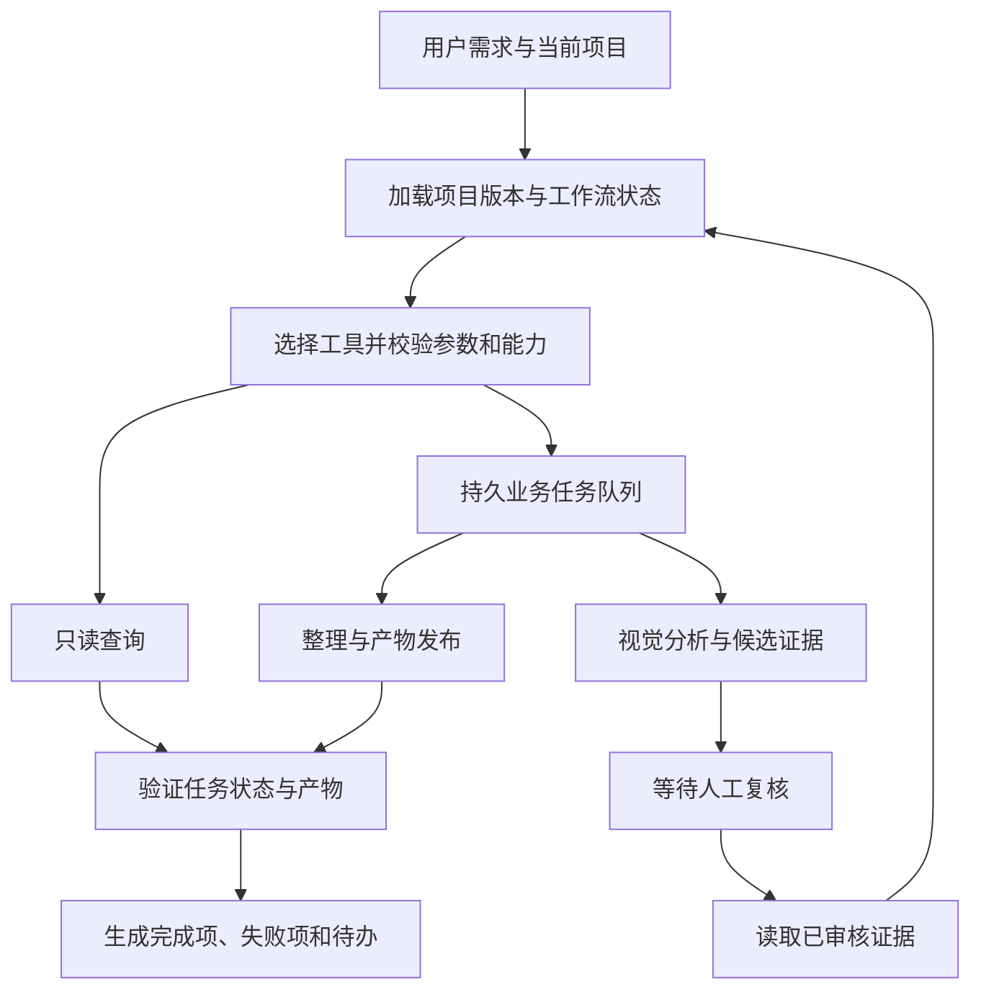

# 智能体优化分析（2026-11-25）

分析基于提交 `8c3c59b` 的本地实现，覆盖 CLI、两套聊天接口、工具注册、会话与任务存储，以及已有视觉分析和后台队列。当前最有价值的优化是：让智能体复用完整业务能力，可靠地执行和恢复任务，并依据真实产物汇报结果。模型选择与训练需要以任务级评测为依据。

现有基础可以继续复用：高级智能体已支持 LangChain 工具循环、JSON/native 协议、参数校验、单轮步数限制和模型失败后的结果收尾；业务后台队列已有 SQLite 检查点、幂等提交、取消、恢复和版本检查；视觉模块已有有条件调用、预算与缓存。新增能力应接入这些边界。

## 优先级与收益

P0 表示优先处理的能力或正确性缺口，P1 表示随后提高任务成功率和可维护性，P2 表示规模与体验优化。投入为相对复杂度，不是已测量的工期。

| 优先级 | 优化项 | 当前证据 | 预期收益 | 相对投入 |
| --- | --- | --- | --- | --- |
| P0 | 长任务接入持久队列，建立跨轮幂等和恢复 | 智能体直接同步执行；去重集合仅存在于一轮 | 请求中断后可查询、恢复，避免重复副作用 | 中 |
| P0 | 补齐视觉分析及业务工具 | 高级 `scene_reason` 明确返回 `visual=False`；缺后台任务和建人脸库工具 | 自然语言操作能调用已实现的完整业务能力 | 中 |
| P0 | 区分执行成功、部分失败、等待审核，验证完成依据 | 所有非异常结果均可进入 `review`；无工具也可接受完成回答 | 减少错误成功提示和未经审核的流程推进 | 中 |
| P1 | 项目级结构化记忆和产物依赖 | 输入参数扁平合并，结果路径不自动提取，旧项目字段保留 | 连续处理多个剧目时减少串用与重复询问 | 中 |
| P1 | 统一两套智能体的工具契约和调度边界 | 旧版只做部分类型转换，高级版做 JSON Schema 校验 | API 行为一致，减少修复成本和参数错误 | 小至中 |
| P1 | 保存模型用量，增加整轮预算和基于失败类型的路由 | JSON 适配丢失 usage；仅有模型次数和工具次数限制 | 能量化延迟、费用和升级收益 | 小至中 |
| P1 | 建立真实模型任务级评测，再优化提示词或训练 | 现有高级智能体验收替换了模型传输层 | 能判断小模型、级联和训练是否提高任务成功率 | 中，需真实模型运行 |
| P2 | 会话增量存储、明确脱敏范围和工作台对话入口 | 每步重写历史；消息与嵌套敏感键保留；工作台未调用 agent API | 改善长期使用成本、日志处理和实际使用体验 | 分项推进 |

## 1. 持久执行与恢复：收益最高的工程改造

[高级工具适配](../../../core_modules/organize/langchain_agent.py) 的 `execute` 在第 170 行调用 `runtime.run`，运行时第 132 行直接执行工具。完整整理在 [主接口](../../../app/main.py) 第 1225 行转入 `execute_staged`；该执行器在 [业务任务模块](../../../app/organize_tasks.py) 第 266 行使用内存 `InlineContext`，没有把执行检查点提交到后台任务数据库。

所以，会话 JSON 和审计存在，并不等于工具中的长任务能恢复。运行时也没有启动时处理遗留 `running` 任务的逻辑。高级智能体的 `completed` 集合在每轮重新创建；补充探针确认相同工具和参数在下一轮会再次执行。运行时重复传入同一个 `task_id` 也会执行两次，并将任务表中的同 ID 记录替换。现有新输出检查能阻止很多直接覆盖，但不能替代任务幂等和输出占用管理。

建议重型工具返回持久业务 `task_id`，把智能体调用记录与后台任务关联。复用 [TaskQueue](../../../core_modules/organize/task_queue.py) 的 `submit/get/cancel/resume` 和现有准备、版本校验逻辑，提取共享提交服务，避免智能体调用自身 HTTP 接口。幂等键应绑定项目、工作流步骤、规范化参数、输入版本及工具契约；同键不同请求要冲突，相同请求返回已有任务。只读查询的缓存和写入幂等应分别处理，允许必要的状态刷新。

图执行需要保存工作流状态及待等待任务，重启后先读取已完成步骤。可以使用 LangGraph checkpointer 或显式工作流表，业务逐图检查点仍由现有 TaskQueue 管理。

验收：重复请求只创建一个业务任务；执行中断后保留已完成项；恢复不能混用输入或模型版本；不同会话争用同一输出能明确拒绝；等待任务不占用长时间聊天请求。

## 2. 接通已有视觉能力与业务闭环

[高级场景工具](../../../core_modules/organize/photo_agent_tools.py) 第 53 行直接调用 `reason_batch`，没有传视觉检索器、视觉模型或预算控制器，返回值明确标记 `visual=False`。它使用文件名与知识库推理，工具描述与实际实现一致。这意味着高级智能体本身尚不能通过该工具进行图文场景分析。

已有 [场景执行器](../../../app/organize_tasks.py) 第 310、359 行支持 `use_embedder`、`use_llm`、`visual_policy`、内容绑定缓存和明确指定的 OCR 图像。高级工具也没有暴露后台队列中的 `face_database`、`face_cluster`，或已审核证据导出。因此，“从新照片开始完成整理”的前置步骤仍需要用户在其他接口完成。

建议增加服务能力查询、持久场景分析、人脸建库/扫描、任务查询及已审核证据导出工具。工具返回稳定的产物 ID、路径、证据类型与待审核状态。CLI 按能力提供文件名分析，视觉服务按实际可用模型提供视觉工具；不存在的模型能力不应只靠提示词解释。视觉调用继续受已有预算和缓存约束，GPU 执行保持现有业务队列边界。

验收：同一输入与配置经工作台和智能体提交得到一致的业务执行契约；响应明确区分文件名、图文检索、画面观察及 OCR；审核完成前不能使用未批准标签推进正式整理。

## 3. 根据业务结果汇报完成状态

[运行时](../../../core_modules/organize/agent_runtime.py) 第 140 行只根据是否抛异常及 `auto_approved` 决定状态。[高级适配](../../../core_modules/organize/langchain_agent.py) 第 171 行据 `state != 'failed'` 设置 `ok`。真实整理报告含 `failed`，场景报告含 `n_failed`，当前适配没有把这些业务失败映射为部分失败或失败。

补充探针返回 `total_input=2, kept=0, failed=2`，工具仍得到 `ok=True, state=review`。这说明 `ok` 当前代表调用未抛异常，不能直接作为业务成功结论。另一个探针让脚本化模型直接回答“已完成整理并导出结果”，没有任何工具调用，系统仍接受该回答。提示词约束没有形成可验证的完成契约；此复现不代表真实模型的幻觉发生率。

建议统一工具结果字段：执行状态、成功/失败计数、产物、证据类型、审核状态和错误码。分开表示“执行完成”和“标签待审核”。最终回答可保持自然语言，但执行完成、产物路径与计数由系统依据任务/产物记录生成或核验。普通问答无需强制调用工具；声称完成操作时必须有可关联的有效执行记录，可以来自已验证的历史任务。

验收：全失败不会提示整理成功；部分失败列出失败数和可恢复方式；模型编造的产物路径不能成为完成凭据；人工审核仍由原复核机制完成。

## 4. 记忆需要保存项目、产物和待办

[会话实现](../../../core_modules/organize/conversational_agent.py) 第 239 行把参数合并为一个扁平字典。高级适配第 175 行只合并成功工具的输入参数，没有提取工具输出。真实建库工具输入为 `output_dir`、输出为 `knowledge_dir`，下一步不能确定性地从结构化记忆获得这一结果映射。

补充探针验证：修改项目输入目录后，旧项目 `output_file` 仍保留；工具结果中的 `knowledge_dir` 没进入记忆。第 137 行的摘要只拼接较早消息中最近 40 条的短片段，久远的待办最终会消失。完整历史虽然落盘，模型看不到的未完成工作仍可能被遗忘。

建议使用 `project_id`、输入版本、知识库产物、候选证据产物、复核队列、已审核证据和待等待任务等结构化字段。产物由可信工具结果更新，用户指定输入与模型建议分开保存；切换输入版本时失效依赖的旧结果。摘要保存决定、待办和产物引用，历史工具结果按任务检索，不把全部数据重复塞进提示词。

验收：项目 A/B 交替对话不会串用输出；建库后无需再次输入知识库路径；长对话和重启后仍能找到待审核任务；已完成写入从记录中复用。

## 5. 统一契约与接口调度

旧版 [参数处理](../../../core_modules/organize/conversational_agent.py) 第 256 行只过滤键、转换部分字符串类型和检查必填参数，没有完整校验范围、枚举及结构。探针注册了有范围和枚举的 schema，旧版仍执行了 `limit=-10, status=unexpected`，并静默丢弃多余键。高级版已有 JSON Schema 校验，两套注册定义也分别维护。

旧版 [聊天路由](../../../app/main.py) 第 1187 行为 `async def`，内部直接调用同步 `agent.chat`，模型或工具调用可阻塞事件循环；高级聊天已经使用同步路由，由框架在线程池运行。

建议共享工具注册表、输入/输出 schema、错误码、能力声明及副作用策略，保留兼容 API 外壳。旧版若保留类型转换，转换后仍完整校验；调度使用线程池或一致的异步实现。不要把白名单校验仅保留在模型提示词中。

验收：两入口对非法类型、范围、枚举、额外参数给出一致结果；长聊天执行期间普通查询仍响应。

## 6. 先测量，再改模型路由与预算

[模型适配](../../../core_modules/organize/langchain_agent.py) 第 85、87 行从 JSON 行动创建新的 `AIMessage`，未保留端点响应的 usage。探针确认端点提供的 `input_tokens/output_tokens/total_tokens` 丢失。现有 trace 主要保存模型索引、协议、级联和错误，没有完整的请求耗时与用量；异常收尾又只保留异常类型。

`auto` 按小模型优先尝试，主要在调用或协议失败时升级。符合行动格式但参数无效的响应会在工具层被拒绝，通常继续消耗当前循环预算；没有基于任务成功率评估的语义升级策略。

建议保存每次实际端点调用的模型身份、输入/输出 tokens、耗时、finish reason、错误类别及升级原因。增加整轮截止时间、累计 tokens/费用上限、参数修复次数和端点熔断。预算统计包含同一次 graph 调用中的小/大模型两次尝试。简单已明确操作可确定性执行，复杂规划或连续参数修复失败再按评测结果升级。

默认 6 次工具、最多 7 次 graph 模型调用；两端点各 60 秒超时时，配置上的模型等待累计可达约 840 秒，另有工具时间。这是按配置计算的边界示例，不是实测延迟。降低超时或切换 native 协议需要端点兼容性和任务评测支持。

## 7. 存储、数据处理与工作台入口

会话每步重写完整消息与工具调用，`_response` 返回全部历史工具调用；运行时每次状态更新读写全任务 JSON。单次成本随历史增长，这是实现层面的规模问题，本次没有测量生产耗时。可复用 SQLite 保存增量消息和执行记录，聊天默认返回本轮调用，历史分页查询，完整结果保留在任务产物中。

`_json_text` 第 40 行按字符截断序列化 JSON。探针产生的长结果被截成非法 JSON，尾部报告路径也消失。应先对结果做结构化摘要，稳定保留状态、计数、产物引用和分页字段，再按 token 预算组装提示词。

敏感键过滤仅作用于长期记忆顶层。探针使用虚构值确认嵌套 `api_key` 和原始聊天内容仍落盘，与现有蓝图描述一致。建议在明确的存储边界递归处理敏感字段，对消息、异常和模型 trace 使用统一策略；路径和任务 ID 等业务引用应保留。这一建议基于实际落盘行为，不表示本次发现了真实密钥泄露。

[工作台脚本](../../../app/static/workspace.js) 已支持后台任务状态和复核，但没有接入 agent 聊天接口。后续对话入口应直接使用当前项目状态，显示执行步骤、业务任务进度和产物跳转，并在等待人工复核时进入现有复核页面。这样可以评估真实使用流程中的重复输入和任务放弃情况。

## 推荐执行链路



该方案保留一个负责对话与选择工具的智能体，复用已有确定性业务执行器。需要复杂规划时再保存明确步骤和依赖；是否拆分多个智能体，应由独立任务比较证明其收益。

## 评测与后续模型优化

建议第一版准备约 60–100 个任务，覆盖目录检查、建库→分析→复核准备、复核后整理、缺参数、切换项目、已有输出、端点失败、执行中断和包含干扰文本的工具数据。普通问答与需要执行的请求分开评价。

离线层继续测试契约与故障边界；真实模型层比较小模型、直接大模型和级联，再在已验证支持的端点比较 JSON/native。真实照片任务独立评价视觉/身份质量，沿用现有数据隔离要求。当前资料中的 final test、框级 unknown 等缺项不能用本次离线探针替代。

主要指标应为：任务正确完成率、参数首次通过率、产物正确性、重复副作用次数、故障恢复率、无依据完成声明率、人工补充次数、P50/P95 延迟及累计 tokens。完成标签由实际产物与任务状态判断；模型自报成功不能作为评测标签。

任务评测稳定后，若小模型仍反复选错工具或填错参数，可用经过产物校验的成功轨迹和参数修复轨迹做 SFT，并绑定工具 schema 版本。RL 需要可验证的终态奖励、步骤成本和独立测试，投入与风险较高，应在前述数据和基线具备后再决定。当前没有证据可以量化更换模型或训练带来的提升。

## 本次验证与复现

本次三组现有离线测试均通过：LangChain 14 项、运行时 6 组、会话 9 组。补充 [探针](probe.py) 验证 11 个边界行为，[记录](findings.json) 保存基线提交与观察结果。探针使用虚构目录、虚构敏感值、脚本化模型及临时目录，没有调用远端模型或 GPU，也没有评价真实剧照质量。

```bash
/home/huachenghao/.conda/envs/agent/bin/python tests/test_langchain_agent.py
/home/huachenghao/.conda/envs/agent/bin/python tests/test_agent_runtime.py
/home/huachenghao/.conda/envs/agent/bin/python tests/test_conversational_agent.py
/home/huachenghao/.conda/envs/agent/bin/python docs/reports/agent_optimization_20261125/probe.py --output /tmp/theatre-agent-probe-new.json
```

复现输出必须使用尚不存在的文件。探针对当前缺口做断言；后续修复后相应断言应失败，并转为期待修复行为的正式回归测试。复现输出额外记录所检查源文件的 SHA-256，便于区分版本。

建议实施顺序：先统一工具结果和共享契约，同时补齐任务级离线用例；随后把重型业务接入队列并公开视觉工具；再完成项目记忆和模型用量记录；最后开展真实模型对照、工作台接入及有证据支持的训练。
