# 幕间：戏剧照片智能整理系统技术报告

技术评审与研发版 · 2026-10-24

<!-- PAGE: executive | 技术摘要 -->
# 从舞台影像到可追溯档案

本系统面向戏剧照片中人物众多、舞台光线复杂、文件名信息不一致、剧情资料分散等问题，将人脸识别、图文检索、视觉观察、人工复核与规范归档整合到“幕间”工作台。核心设计是把**模型候选、证据来源和人工决定**作为不同对象保存，使结果能够解释、重跑和恢复。

当前实现已具备可用的照片整理与复核闭环。工程验证覆盖真实GPU任务、服务中断恢复、万条复核队列、原始照片及已整理照片的再次处理。模型研究以4部剧目、262张已确认幕次的开发集图片为核心，比较SigLIP2与本地EmbeddingGemma 2的长文、短块均值及最大值聚合方案。[S02][S11][S12][S15][S16]

<div class="kpi-grid"><div><b>262</b><span>幕次检索开发样本</span></div><div><b>76.34%</b><span>Gemma短块均值 R@3 · 25池</span></div><div><b>1,095</b><span>可追溯检测人脸</span></div><div><b>200</b><span>真实流程验证图片</span></div></div>

## 主要技术结论

1. **文本组织会改变检索质量。** 25候选池中，短块均值R@3为SigLIP2 69.85%、Gemma 76.34%；Gemma比同方案SigLIP2净增17张命中。扩展至28候选后，两者变为53.44%和71.76%，说明候选覆盖与竞争必须一起分析。[S02]
2. **工程可靠性已有真实证据。** 292图任务完成1095脸检测和453个旧算法簇，经历取消、部分发布失败和恢复后无项目失败；17项恢复检查通过。[S12]
3. **优化收益取决于测量边界。** 万条合成队列的单条保存及摘要中位耗时由214.706 ms降至1.850 ms；U2历史特征阶段仅1.151倍，未达到既定吞吐门槛。[S13][S14]
4. **现有材料支持开发比较，尚不支持正式质量通过。** 缺少独立final test、框级身份、双人事实、时序边界和连拍偏好标注。默认保持SigLIP2及legacy分组，U2按用户要求暂停。[S17][S18]

<div class="callout">本文的“通过”均指明确的测试或检查范围。模型观察有效、接口成功和文件完整，不等同于身份识别准确、幕次判定可靠或选优质量达标。</div>

**阅读路线**：第3—11页介绍功能和原理；第12—16页定义实验并展开检索结果；第17—22页分析视觉、分组、性能和真实流程；第23—26页给出质量缺项、复现方法、证据索引和方法参考。报告基于代码提交`ad68c89`，数据截至2026-10-24；未为撰写报告重新进行模型推理。

<!-- PAGE: capabilities | 01 系统功能 -->
# 面向整理人员的一体化工作台

工作台以项目为单位共享照片目录、剧情知识库、人脸库和复核状态，减少在多个工具之间搬运标签与路径。入口`/organize`与`/ui`共用新版工作台，旧版功能仍可从`/legacy`进入。

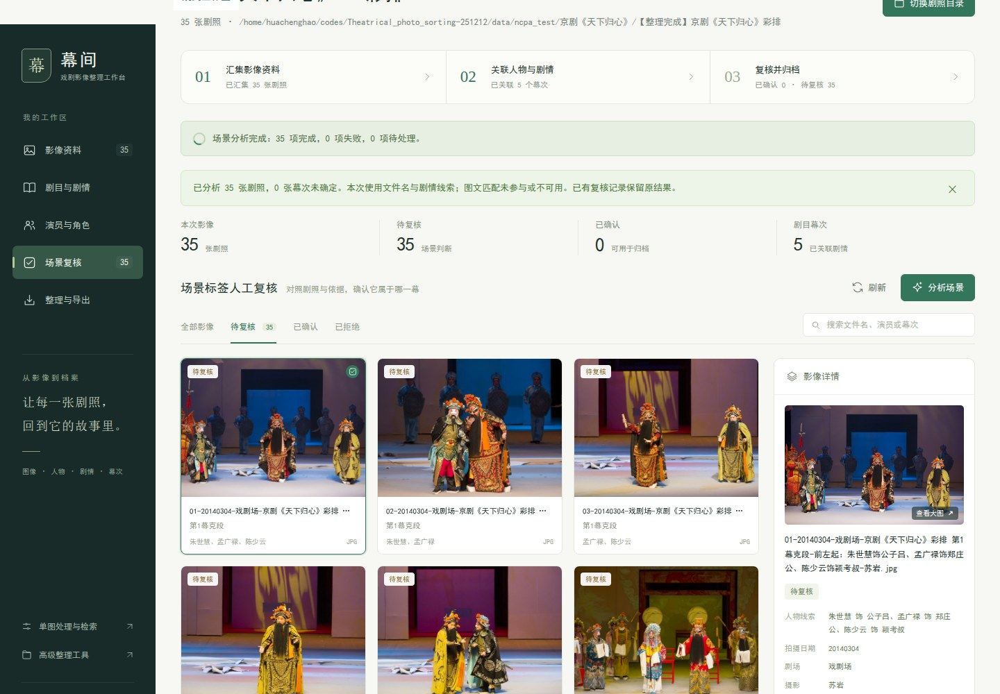

| 功能域 | 输入与主要处理 | 输出及使用方式 |
|---|---|---|
| 影像资料 | 目录扫描、缩略图、文件名解析、搜索筛选 | 日期、剧场、剧目、演员线索与图片网格 |
| 剧目与剧情 | 本地资料或来源快照、幕次正文、图文向量 | 可追溯知识库与候选幕次 |
| 演员与角色 | 检测、对齐、向量匹配、显式身份注册表 | 稳定身份ID、当前剧目角色、演员专辑 |
| 场景复核 | 原图、候选、来源、修改/拒绝/确认 | 版本化决定、修订日志、最终标签 |
| 整理导出 | 连拍分组、选优、场景证据与命名规则 | 规范文件名、源图映射、复制/跳过报告 |
| 辅助视觉能力 | RTDETR-X、YOLO分割/姿态、LAMA、图像检索 | 人像区域、景别、背景修复与相似图等既有接口 |

辅助视觉能力属于仓库已有功能，本报告的主实验集中于身份、幕次检索、视觉证据、任务可靠性与整理流程；未把所有辅助模型重新做精度横评。

浏览器检查覆盖1440、1024、768、540和390像素宽度，验证切图、草稿、刷新、导出、错误提示及任务状态。GPU操作在浏览器回归中部分使用替代响应；真实GPU流程另外报告，避免混淆验证层次。[S19]

<!-- PAGE: architecture | 02 系统架构 -->
# 模型能力与可靠性基础设施协同

系统采用Python服务端与轻量浏览器界面。FastAPI提供工作台与业务API；任务执行器承接长操作；共享特征服务减少重复编码；SQLite保存复核和任务状态。算法模块通过带版本的输入、输出和证据对象连接。

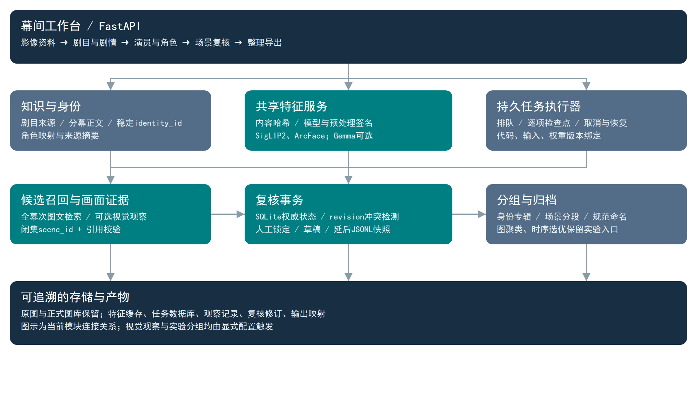

## 三条相互约束的处理链

**身份链**：源图→检测框→五点对齐→人脸特征→身份级竞争→当前剧目角色。身份注册表解决“同一演员多个角色目录”和“同名不同演员”问题。

**场景链**：剧目来源→候选幕次→图文召回→可选画面/OCR证据→闭集判定→人工复核。机器判断保留候选与引用；人工决定锁定后，重分析不得覆盖。

**执行链**：输入清单→版本契约→逐项任务→检查点→原子发布。恢复前核对源码、输入、模型和配置；版本不一致时要求新建任务，防止将旧中间结果混入新流程。

<div class="note">工程边界：原图与正式图库作为受保护输入；实验使用隔离输出与图库副本。浏览器草稿是本地未提交编辑，SQLite中的已确认修订才是服务端决定。</div>

<!-- PAGE: data | 03 数据与样本范围 -->
# 明确“文件数”“图片数”和“标注数”

原始清单覆盖582份文件，包含原始照片、整理后副本及资料图。内容去重后有319张可解码图像，其中292张具有舞台照线索、27张具有资料图线索；类别线索仍有待人工复核，不能把文件副本当作独立样本。[S01]

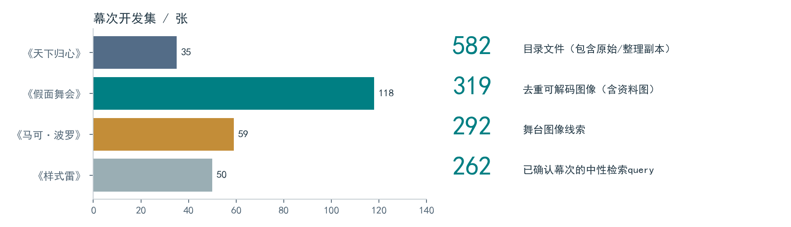

| 数据对象 | 当前数量 | 可支持的结论 |
|---|---:|---|
| 已确认整理文件名标签 | 263张 | 其中262张有幕次；人物列表不保证穷尽所有可见人脸 |
| 当前检索query | 262张 / 4剧目 | 中性路径与图像输入下的开发集候选召回 |
| 剧目内身份 | 35个 | 注册表中的明确身份/角色关系，不等于35人已完成框级评测 |
| 正式图库裁剪 | 109份 | 来源待核验；108份裁剪的名称对应46张历史query |
| 逐脸复核包 | 292图 / 1095脸 | 检测结果和原图框位置可追溯，人工身份标签仍为0 |
| 照片划分复核 | 375项 / 14相机流线索 | 场次、时钟、近重复、连拍、图库来源的待处理材料 |

## 数据隔离策略

检索使用中性PNG与不携带幕次、人物答案的路径；原标签仅用于评分。所有同源副本以内容摘要关联，图库与query需进一步隔离近重复及连拍。现有每剧目只有有限日期/场次线索，尚未形成可证明独立的final test。

262版本由旧260幕次版本补回两条已确认但被连字符解析漏读的标签，原260标签保留不变。历史报告的分母不被追溯改写，新协议分别报告历史260、新增2和全部262。[S02][S03]

<!-- PAGE: face | 04 人脸模型原理 -->
# SCRFD检测、ArcFace表征与身份决策

**SCRFD**在多尺度特征上预测人脸置信度、边框和五个关键点，通过阈值过滤与非极大值抑制去除重复框。项目实测契约记录检测输入640×640、置信度阈值0.5、NMS阈值0.4。照片框位置需与缩放、解码方向一致，复核页面再投影回原图。[S12]

**五点对齐与ArcFace**：利用双眼、鼻尖、嘴角估计相似变换，将人脸映射至112×112标准输入；编码后得到归一化人脸向量，当前图聚类使用512维向量。对齐减少位姿差异，但侧脸、浓妆、遮挡与小脸仍会削弱身份信息。

<div class="equation">L<sub>ArcFace</sub> = −log { e<sup>s·cos(θ<sub>y</sub>+m)</sup> / [ e<sup>s·cos(θ<sub>y</sub>+m)</sup> + Σ<sub>j≠y</sub> e<sup>s·cosθ<sub>j</sub></sup> ] }</div>

式中角度间隔m用于原模型训练，使同身份特征更紧凑、不同身份更分离；s为尺度。**本项目使用预训练模型推理，没有训练上述损失，也未重新估计m。** 推理阶段比较归一化向量的内积，即余弦相似度。

## 身份级聚合与拒识

先把属于同一`identity_id`的图库目录或锚定结果合并，再取该身份最大匹配分。这样多个角色目录不会互相成为“第二身份”，也不会把一张脸输出为多个演员。

<div class="equation">S<sub>k</sub> = max<sub>a∈A(k)</sub> sim(f, a)；接受 k* ⇔ S<sub>k*</sub> ≥ τ 且 S<sub>k*</sub> − S<sub>second</sub> ≥ δ</div>

τ为相似度阈值，δ为身份间分差；无第二候选时按实现仅检查阈值。分数、第二名、margin、锚定来源和拒绝原因一同保存。当前阈值与margin属于可配置工程参数，尚未由隔离的已知/unknown人脸集完成校准。

角色由当前剧目的已确认演员表关联。多角色冲突保留演员身份，不根据外观猜当前角色。文件名未列名不能用作unknown真值；unknown应表示不属于所选图库身份集合，而非“系统暂未识别”。[S17]

<div class="note">实测1095脸是检测结果集合，不覆盖漏检人脸，也不表示1095个真实人物。身份召回、未知误报率和框级聚类质量目前均未完成验收。</div>

<!-- PAGE: embeddings | 05 图文模型原理 -->
# 共享向量空间中的幕次检索

幕次候选检索把图像与场次文本编码到共同空间，图文向量分别L2归一化后计算点积。它度量语义相容性，不直接证明人物身份或精确幕次。

<div class="equation">v = f<sub>image</sub>(I) / ‖f<sub>image</sub>(I)‖₂；t = f<sub>text</sub>(D) / ‖f<sub>text</sub>(D)‖₂；s(I,D) = vᵀt</div>

## SigLIP2：双编码器与成对匹配

项目默认使用`siglip2-base-patch16-384`，图像输入384×384，输出768维特征。图像编码器利用视觉Transformer聚合patch信息，文本编码器提取文本语义。SigLIP系列的基础训练目标使用成对sigmoid匹配，而不是要求所有候选共享一个softmax归一化分母。

<div class="equation">L<sub>pair</sub> ∝ Σ<sub>i,j</sub> log[1 + exp(−y<sub>ij</sub>(α·v<sub>i</sub>ᵀt<sub>j</sub> + β))]</div>

y取正负配对标签，α、β为训练中的尺度与偏置。上式解释匹配目标；报告中的检索分数实际使用向量点积，未把训练logit当作校准概率。此本地配置的文本窗口为64 tokens，较长分幕正文会被截断，因此文本组织成为重要实验因素。[S03]

## EmbeddingGemma 2：本地多模态嵌入接口

本地checkpoint的`model_type=embedding_gemma2`且含视觉配置。适配器使用SentenceTransformers，将多模态表示进行均值池化和归一化，输出768维向量。文档使用checkpoint定义的`Document`前缀（`title: none | text:`），图像使用空前缀；音频配置在本任务中关闭。

| 实现契约 | SigLIP2 base | 本地EmbeddingGemma 2 |
|---|---|---|
| 本任务输出 | 768维归一化向量 | 768维归一化向量 |
| 文本处理 | tokenizer固定窗口、长文截断 | checkpoint的Document提示与池化规则 |
| 模型入口 | Hugging Face图文模型 | SentenceTransformer多模态输入 |
| 数值与依赖 | 沿用冻结签名 | 支持时BF16，否则FP32；禁止FP16 |
| 默认状态 | 当前默认检索后端 | 显式可选实验后端 |

模型权重、预处理、文档前缀、软件包版本均进入签名；不同配置的向量不能直接混用。本文关于Gemma结构的描述以本地checkpoint与适配器为依据，未推断未核验的训练配方。

<!-- PAGE: textblocks | 06 有出处的文本与短块消融 -->
# 将文本覆盖与模型差异分开测量

原25候选中仅5个有分幕正文，其余20个主要是标签。来源增补后增加12个有出处的场次正文，另保留8项正文缺口；扩展28池追加《马可·波罗》的3个明确候选。来源正文与照片演出版是否完全等价仍需核验，尤其2014与2015巡演文本的调整不能静默合并。[S02][S03]

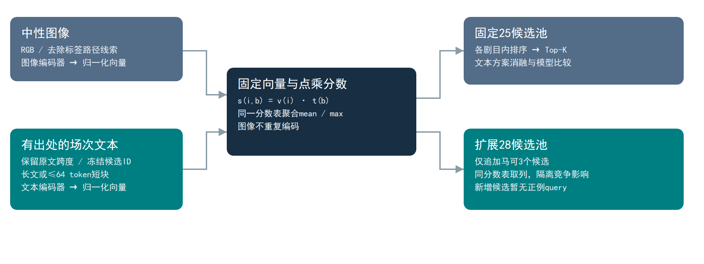

## 两种聚合、一个主方案

正文按可追溯原文跨度分成82个短块，每块不超过本地SigLIP2的64-token预算。历史研究保存102份去重文档向量；262协议复用它们，并补编码12份缺失基线标签文本。不是为每个变体重新编码全部图片。

<div class="equation">s<sub>mean</sub>(I,c) = |B(c)|<sup>−1</sup> Σ<sub>b∈B(c)</sub> vᵀt<sub>b</sub>；s<sub>max</sub>(I,c) = max<sub>b∈B(c)</sub> vᵀt<sub>b</sub></div>

均值聚合是预先指定的主方案，各块等权；短尾块也会获得相同权重。最大值是次方案，可捕捉局部匹配，但块数较多的候选更容易取得偶然高分。即使最大值取得较好结果，也不能事后替换主方案并忽略偏差。

排序在**已知剧目内部**进行，25/28指跨4剧目的总候选数。各剧目的候选规模不同；《马可·波罗》原池仅3个候选，因此该剧原池R@3=100%具有结构性，不足以单独证明优秀检索能力。

<!-- PAGE: visualprinciple | 07 视觉证据与OCR -->
# 先描述可见事实，再做闭集判断

视觉路径把图片本身传入模型，先收集服饰、道具、布景、动作、可见文字和不确定项，再结合剧情候选做闭集幕次选择。模型只能选择现有`scene_id`或`unknown`，引用必须指向已提供证据，数值字段和JSON结构也必须合法。

## 请求预算与失败行为

自动模式根据候选分差、证据不足等条件决定是否补充观察；图像额度、实际HTTP请求和最大输出tokens分别计数。预算以每次请求的上限预留，避免错误重试或隐式级联超支。无预算、观察失败或输出越界时保留降级原因并进入人工复核。

| 控制项 | 本次已验证行为 |
|---|---|
| 图像输入 | EXIF方向处理、最长边限制；默认视觉预览最大边1280 |
| 观察结构 | 5类可见事实 + uncertain，字段校验后持久化 |
| 判定范围 | 候选幕次ID或unknown，禁止创造新幕次/伪造引用 |
| 自动预算实验 | 100图中15图观察，15次观察 + 15次闭集选择 |
| 按需材料收集 | 100图各1次观察，不进行新的闭集选择 |
| 重放 | 同进程缓存复用；两项实验的新增请求均为0 |

模型输出中的服装、动作与文字不能代替演员身份识别。独立双人复核按事实判断“支持/错误/不可评价”，并记录重复描述与遗漏；合法JSON比例与事实正确率是不同指标。[S05][S06][S18]

## OCR提供补充文本，不生成身份真值

PaddleOCR以独立worker处理明确含字图片，返回文字行、位置和置信度等观察信息。实际5图实验检查了输入、模型摘要与缓存重建；目前无逐字人工参考，不能计算真实OCR准确率。复核界面只显示图片与空白转录框，不显示模型预测，以减少抄写预测造成的偏差。[S07]

<div class="callout">远端服务别名为Qwen3.6-27B，配置声明为Qwen3.8-27B。元数据接口没有提供可核验的权重摘要；本报告称其为“现有视觉服务”，不据名称推断实际参数规模、版本或模型架构。[S20]</div>

<!-- PAGE: grouping | 08 图聚类与时序分组 -->
# 从局部相似度到受约束的候选分组

## 人脸图聚类：互近邻、不能合并约束与漂移控制

对归一化ArcFace向量执行FAISS精确内积近邻搜索。两个点互为k近邻且相似度达标时生成边，再按边分数顺序合并簇。合并需同时通过簇大小、cannot-link、质心相似度和所有成员对新质心的最低相似度检查，避免“相似链”逐步跨越身份。

| 参数 | 当前实验默认 | 作用 |
|---|---:|---|
| k近邻数 | 16 | 控制候选边数量 |
| 边相似度 | ≥0.60 | 排除弱局部连接 |
| 质心/成员相似度 | ≥0.65 | 限制合并后的身份漂移 |
| 簇大小上限 | 512 | 限制单次成员检查开销 |
| 同图不同检测框 | 假定cannot-link | 镜像、合成、重复检测需人工例外 |

**复杂度边界**：实现避免构造Python层N×N矩阵，边存储约O(Nk)；但`IndexFlatIP`仍是精确搜索，计算复杂度约O(N²d)，不能据此声称整体线性扩展。[S08][S09]

## 窗口变化点：相邻视觉分布的差异

利用归一化特征的前缀和计算边界左右窗口向量和，取余弦距离作为变化分数；按峰值贪心选点，同时约束最短段长。当前默认窗口4图、最短段4图、阈值0.12，长时间间隔参数300秒。

<div class="equation">g(t) = 1 − cos( Σ<sub>i=t−w…t−1</sub> v<sub>i</sub>, Σ<sub>i=t…t+w−1</sub> v<sub>i</sub> )</div>

评分阶段约O(Nd)，但有序峰值插入在最坏情况下仍可能O(N²)。视觉变化是边界候选；灯光变化、机位切换、彩排回演不自动等于剧情换幕。

## 连拍研究：可信时序与同配额选优

只合并同一可信相机流中的邻近图片：相邻间隔≤2秒、整组跨度≤8秒、首尾视觉相似度≥0.97，最多24张；已确认幕次冲突禁止合并。时间不可信时保守输出单图组。后续选择按相同保留配额比较质量与多样性；现有262图仅1个两图组，不满足选优评测条件。[S10]

<!-- PAGE: reliability | 09 持久任务、缓存与复核事务 -->
# 让长流程能够安全恢复

每个长任务保存输入清单、模型与源码契约、逐项状态及阶段检查点。人脸任务将检测、对齐裁剪和预览分别持久化；恢复时复用已完成文件，避免重跑检测或裁剪。复制前后验证源文件摘要，输出采用临时文件与原子替换。[S12]

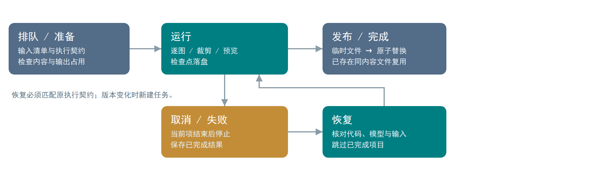

## 内容缓存的有效性条件

图像缓存键以内容摘要关联，叠加模型权重和预处理签名、维度与数据类型。文件大小和修改时间可加速检测，但不能代替最终内容证明。模型权重或代码变化时检查点失效，不能通过修改任务状态强行续跑。

远端权重未核验时保留进程私有身份，阻止把“服务名称相同”误当成跨进程模型完全相同。视觉请求的同进程重放成功因此只证明本进程缓存复用。

## SQLite作为复核权威状态

服务端以事务保存决定和不可变修订历史，客户端携带`expected_revision`；同条记录被其他客户端修改时返回冲突，刷新最新记录并保留本地草稿。机器重分析只更新pending候选，保留人工确认或拒绝。

工作台的单条保存显式启用`defer_snapshot`，先提交SQLite，再在导出时生成兼容JSONL。旧调用默认即时快照；元数据与当前页详情从数据库读取。快照缺失或旧文件未更新时，场景证据也读取权威数据库，避免“保存成功、整理却读旧标签”。[S13]

恢复可靠性与吞吐改善分别衡量。事务、检查点和内容校验会带来开销，但它们防止半写文件、重复发布、人工决定丢失及版本混用。

<!-- PAGE: setup | 10 实验环境与设计 -->
# 采用冻结协议，保留各实验的测量范围

本文汇编的是2026-10-21—24期间的多组实验，不是一次统一、独占硬件的最终benchmark。每组报告保留自己的源码摘要、输入、模型身份和运行日志；下列环境来自对应原始记录。[S04][S08][S12][S21]

| 项目 | 报告记录的设置 |
|---|---|
| 主要GPU | NVIDIA GeForce RTX 3090，24 GiB；U4/U3等使用物理GPU1；共享占用 |
| CPU规模实验 | Montage Jintide C4215R，32逻辑CPU；独立worker，每方法4线程 |
| 视觉运行环境 | Python 3.10环境；PyTorch 2.9.0+cu130；部分报告Transformers 5.15.0 |
| ONNX人脸推理 | ONNX Runtime GPU 1.23.2；真实292图契约为CUDA + CPU provider |
| Gemma隔离依赖 | requirements中固定Transformers 5.20.1、SentenceTransformers 6.1.0等；具体运行签名另存 |
| 批量/解码 | 历史U2 batch=8、decode workers=2；torch CPU线程16 |
| CPU合成特征 | seed=20261023；噪声σ=0.006；窗口768维、脸聚类512维 |

## 实验矩阵

| 研究 | 样本与重复 | 对照及保持项 |
|---|---|---|
| 幕次检索U4 | 262图，2后端×7变体 | 固定query/GT；25/28池，长文/短块均值/最大值 |
| 视觉证据U5 | 自动100图；按需另100图 | 实际请求计数、结构校验、重放缓存 |
| 分组规模U6/U7 | 10000预计算特征，每方法1次 | 图与层次聚类共享同一512维输入；特征生成不计时 |
| HTTP可靠性U3 | 292真实图、5客户端、60秒、总5请求/秒 | 一万条复核元数据负载；查询与任务创建分别统计 |
| U2性能 | 200唯一图/4剧目/8目录，各5次 | corrected baseline对批量/缓存，分阶段计时 |
| 整理工作流U8 | 200图/4项目，两种输入形式各1轮 | 原始文件与已整理命名分别验收，均使用隔离图库 |

262检索协议每后端只新增编码2张图和12份文本，历史260图与102文档向量直接复用。增量编码时长不能拿来比较两模型完整吞吐。各性能实验共享资源、计时边界与重复次数不同，不将它们拼成一条总加速曲线。

<!-- PAGE: metrics | 11 指标定义 -->
# 使每个百分比都能追溯到分母

## 幕次召回与分类

<div class="equation">Recall@K = (1/N) Σ<sub>i=1…N</sub> 𝟙[y<sub>i</sub> ∈ TopK(i)]</div>

当前各图使用一个已确认幕次标签，N=262；Top-1命中率可视为当前闭集标签下的准确率。R@3用于衡量候选列表是否覆盖正确场次，不能代替自动选中第一名的质量。候选按剧目内排序，小候选池会天然抬高R@K。

<div class="equation">F1<sub>c</sub> = 2TP<sub>c</sub> / (2TP<sub>c</sub>+FP<sub>c</sub>+FN<sub>c</sub>)；Macro-F1 = (1/|C|) Σ<sub>c∈C</sub> F1<sub>c</sub></div>

262研究的Macro-F1按协议预声明的25个已确认GT幕次类计算；扩展的3个无正例候选不新增为GT平均类别，但预测落入它们会令真实类别产生漏报。`scene_macro_recall_at_1`不是Macro-F1，本文不将二者混用。[S02]

## 人脸、事实、文字与性能

| 指标 | 正确解释与当前限制 |
|---|---|
| B-cubed P/R/F1 | 每个已标注人脸在预测簇与真实身份簇中的交集比例；当前仅对明确known、可评价、非例外子集定义 |
| unknown FPIR | 未知query被错误接受为图库身份的比例；需隔离gallery/query及足量未知真值，当前为空 |
| 事实错误率 | 双人已完成且一致的error / (supported + error)；pending、分歧和不可评价单列 |
| OCR CER | 编辑距离总和 / 参考字符总数；只使用双人转录一致项，空分母保持null，插入可令CER>1 |
| HTTP P95 | 对原始请求延迟样本取95百分位；取消只有1次，应读作单次确认耗时 |
| 峰值RSS | 对应worker进程的常驻内存峰值；不等同GPU显存，也不是算法数组净内存 |
| speedup | 相同测量边界内T基线/T候选；不跨不同输入范围和计时协议比较 |

检索配对分析保留“新增命中/失去命中”，同时按4剧目重采样生成探索性区间。仅4个剧目且未按独立演出、近重复组完成分层，区间不能视为对新演出的最终泛化保证。[S02]

<!-- PAGE: fullresults | 12 幕次检索全量结果 -->
# 14种变体在同一262图开发集上的结果

表中所有百分比由保存的整数命中数与原始指标生成。25/28是跨剧目候选总量；“原文基线”使用冻结向量重建，不是重放所有历史独立运行。主方案为短块均值，最大值为次方案。[S02]

| 后端 | 文本/候选池 | Top-1 | R@1 | Top-3 | R@3 | Macro-F1 |
|---|---|---:|---:|---:|---:|---:|
| SigLIP2 | 原文基线 · 25 | 49 | 18.70% | 143 | 54.58% | 12.10% |
| SigLIP2 | 增补长文 · 25 | 38 | 14.50% | 160 | 61.07% | 10.53% |
| SigLIP2 | 短块均值 · 25 | 61 | 23.28% | 183 | 69.85% | 13.43% |
| SigLIP2 | 短块最大值 · 25 | 61 | 23.28% | 180 | 68.70% | 14.24% |
| SigLIP2 | 增补长文 · 28 | 37 | 14.12% | 129 | 49.24% | 10.19% |
| SigLIP2 | 短块均值 · 28 | 60 | 22.90% | 140 | 53.44% | 13.42% |
| SigLIP2 | 短块最大值 · 28 | 57 | 21.76% | 153 | 58.40% | 13.74% |
| Gemma 2 | 原文基线 · 25 | 43 | 16.41% | 148 | 56.49% | 12.67% |
| Gemma 2 | 增补长文 · 25 | 80 | 30.53% | 190 | 72.52% | 20.61% |
| Gemma 2 | 短块均值 · 25 | 72 | 27.48% | 200 | 76.34% | 15.69% |
| Gemma 2 | 短块最大值 · 25 | 101 | 38.55% | 202 | 77.10% | 25.31% |
| Gemma 2 | 增补长文 · 28 | 61 | 23.28% | 176 | 67.18% | 17.55% |
| Gemma 2 | 短块均值 · 28 | 56 | 21.37% | 188 | 71.76% | 14.72% |
| Gemma 2 | 短块最大值 · 28 | 83 | 31.68% | 184 | 70.23% | 23.92% |

## 如何解读这张表

**主方案的Top-3改善强于Top-1。** 25池Gemma短块均值为72/262 Top-1、200/262 Top-3；SigLIP2为61/262、183/262。候选覆盖较好不意味着第一名已足够可靠。

**最大值结果需要保留选择偏差说明。** Gemma最大值25池R@1=38.55%、R@3=77.10%、Macro-F1=25.31%，是本表较高结果，但它是次方案，存在块数偏置，没有独立final test支持默认替换。

**新协议和历史数值不可混写。** 旧260独立Gemma原文基线为45/151命中；当前冻结向量重建的历史子集为42/147，全262为43/148。六种长文/分块历史结果与向量则按协议精确保留；基线差别被明确记入报告。[S02]

<!-- PAGE: retrievalanalysis | 13 主结果与消融解释 -->
# 更完整的短文本覆盖改善候选召回

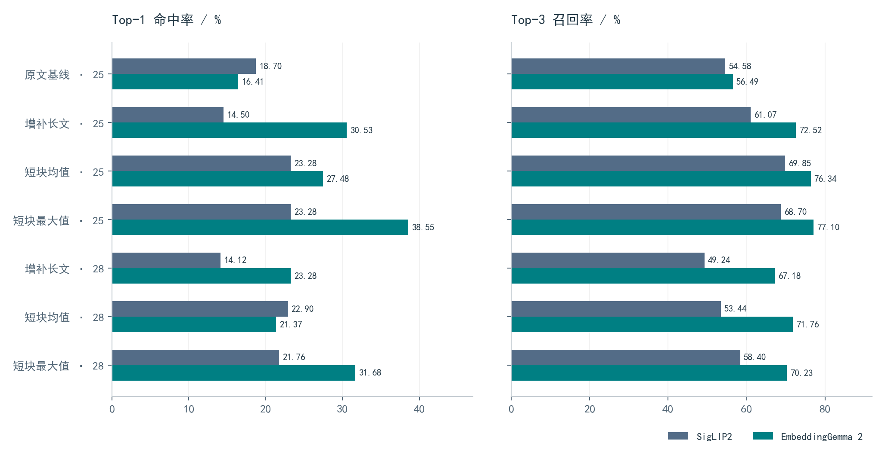

25池内，SigLIP2从增补长文的61.07% R@3提升到短块均值的69.85%，增加23张命中；Gemma从72.52%提升到76.34%，增加10张。分块缓解短窗口截断，并使不同内容段分别进入候选评分，但收益随剧目和聚合方式变化。

## 同方案模型配对比较

| 对比：Gemma − SigLIP2 | R@1差值 | R@3差值 | R@3新增/失去命中 |
|---|---:|---:|---:|
| 短块均值25池 | +4.20 pp | +6.49 pp | +52 / −35，净+17 |
| 短块均值28池 | −1.53 pp | +18.32 pp | +86 / −38，净+48 |

均值25池R@3差值的四剧目探索性重采样95%区间为[+0.92,+10.46] pp；28池为[+4.71,+41.41] pp。28池更大的差值主要受马可新增候选竞争影响，不能直接解释为所有类型剧照都得到同等收益。

<div class="note">pp表示百分点。以上是开发集上的配对观察，数据独立性与演出版等价性尚不足，当前默认继续保留SigLIP2。</div>

<!-- PAGE: poolanalysis | 14 逐剧目差异与候选竞争 -->
# 总体提升掩盖了明显的剧目差异

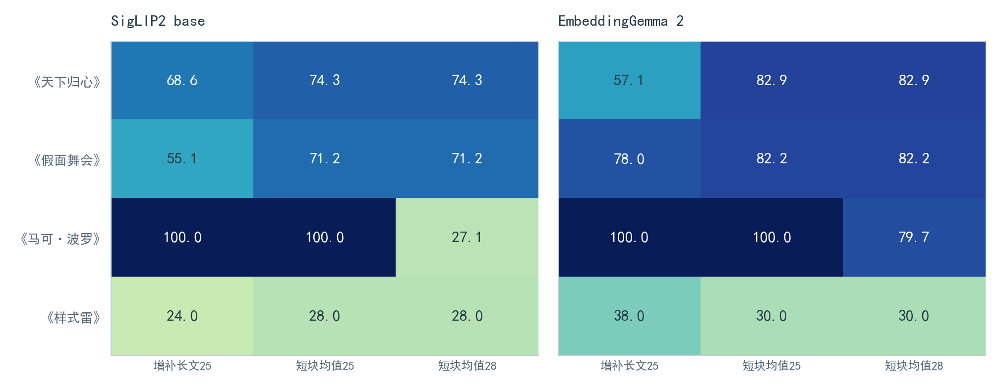

《样式雷》是当前明显短板：Gemma增补长文25池R@3=38.0%，短块均值降至30.0%；SigLIP2相应为24.0%与28.0%。平均收益不能替代对困难剧目、缺失正文和特定场次的诊断。[S02]

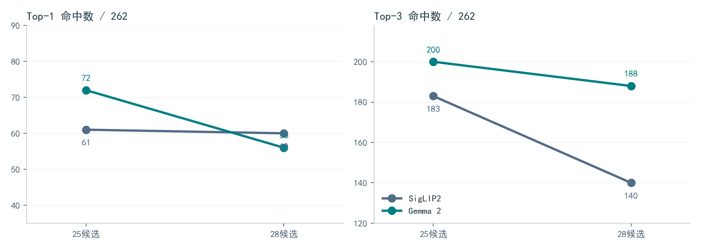

扩池时，SigLIP2 Top-3从183降至140（−43张），Gemma从200降至188（−12张）；新增竞争全部作用于马可。该剧59图的均值R@3从两模型均为100%降为27.12%与79.66%。新增第三/第四幕及尾声候选缺少对应正例query，因此当前测试不能证明完整候选池上的分类能力。

<!-- PAGE: visualresults | 15 视觉观察与OCR结果 -->
# 真实请求已经验证，事实质量仍待人工

| 实验 | 输入图数 | 实际观察图 | 观察请求 | 闭集请求 | HTTP总请求 | 重放新增 |
|---|---:|---:|---:|---:|---:|---:|
| 自动预算 | 100 | 15 | 15 | 15 | 30 | 0 |
| 按需复核材料收集 | 100 | 100 | 100 | 0 | 100 | 0 |

自动实验有效schema比例为100%，15次闭集选择通过约束校验，越界选择为0；14项完整性检查通过。按需实验生成100份有效观察，10项检查通过，耗时429.52秒；该耗时包含远端服务等待，不是同模型受控吞吐测量。[S05][S06]

## 为什么schema通过不能写成“事实准确率100%”

schema只验证字段类型、枚举、候选ID与引用是否合法；一个格式正确的描述仍可能认错道具、动作或文字。现有100图共1352条可复核事实，A/B两位实际复核人数为0，因此事实错误率必须为`null`，而不是0%。[S18]

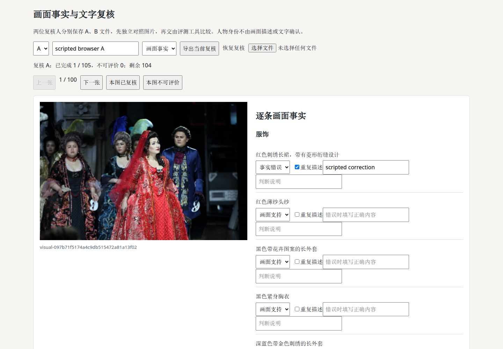

5图PaddleOCR实验完成真实处理与缓存重建检查，但尚无一致参考转录，CER同样为空。复核工具把不确定、不可评价、分歧、重复描述及遗漏分别记录；不以丢弃困难项的方式提高结果。

远端缓存证明局限于当前进程，实际权重摘要仍缺失。更完整的质量报告需要两位独立复核人、足够图像覆盖、明确分母，以及与幕次判定效果的联合评测。

<!-- PAGE: scale | 16 图聚类与时序研究结果 -->
# 规模检查通过，身份与边界质量未定

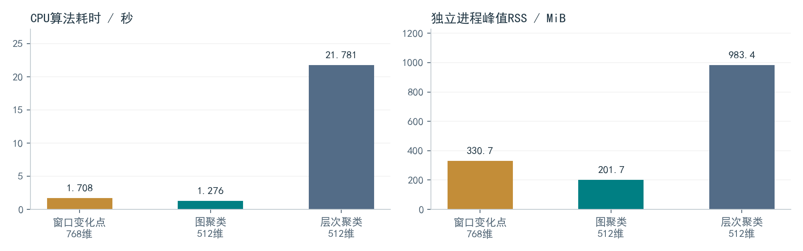

| 方法 | 输入维度 | 耗时 | 进程峰值RSS | 数据与结论范围 |
|---|---:|---:|---:|---|
| 窗口变化点 | 768 | 1.708 s | 330.7 MiB | 预计算序列，算法规模检查 |
| 图聚类 | 512 | 1.276 s | 201.7 MiB | 与层次聚类相同合成人脸向量 |
| 层次聚类 | 512 | 21.781 s | 983.4 MiB | 对照实现，合并策略与图方法不同 |

图聚类/层次聚类的本次算法耗时比为17.066倍，RSS约为后者20.5%；共享CPU、单次运行和不同合并策略限制了结论。真实身份质量可能随着更保守的合并策略而出现过分裂，不能以速度证明聚类更好。[S08]

## 真实1095脸与262图探索

同一组1095脸向量上，legacy生成453簇，graph生成616簇；4200对假定同图cannot-link约束的违反数由29降为0。这只验证算法遵守提供的约束，镜像与重复检测例外尚未核对；框级身份标注为0，B-cubed F1不能计算。[S09][S17]

262图的14条相机流线索缺少可信时钟/连续性核验。保守策略输出262个单图组；仅探索性放宽时序假设后得到260个单图组及1个两图组，三张以上连拍组为0。无法开展60个三图以上连拍组的正式选优评测，也不能计算真实边界F1。[S10]

<div class="note">DINOv3、AdaFace、TOPIQ与MUSIQ在本轮没有运行对照，属于待验证研究选项。默认分段与人脸聚类均保持legacy。</div>

<!-- PAGE: responsiveness | 17 服务响应与复核存储 -->
# 长任务期间保持可查询、可取消、可复核

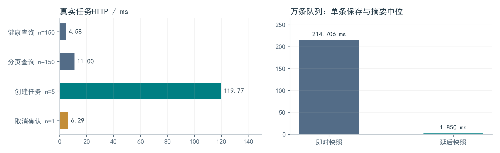

## 真实HTTP任务响应

5客户端、60秒、总5请求/秒、10000复核记录负载下：健康查询150次P95=4.577 ms，分页查询150次P95=10.998 ms，5次不同任务创建P95=119.771 ms；单次取消确认6.288 ms，最终停止等待约10.504 ms。10项检查通过，HTTP错误0。[S11]

## 复核快照：减少每次决定的全量文件工作

| 保存模式 | 5次中位：保存+摘要 | 保存期间JSONL替换次数 | 重启读取 | 导出一致性 |
|---|---:|---:|---|---|
| 旧即时模式 | 214.706 ms | 10 | 读取最新决定 | 通过 |
| 工作台延后模式 | 1.850 ms | 0 | SQLite读取最新决定 | 通过 |

本实验用10000条合成记录，同一机器顺序执行，计时包含单条决定和摘要查询。差异主要反映避免每次重写完整兼容快照；这不是HTTP并发测试，也不是图片整理端到端加速。报告绑定版本早于后续“无快照场景证据读取”修复，应保留其原版本范围。[S13]

工作台另验证了一次元数据加载、详情批次36/36/1、全队列详情请求0。单条决定后更新对应记录与统计；冲突时刷新该条并保留草稿。存储13项、工作台API27项和五屏宽浏览器已有通过记录，具体测试版本保留在完成核查目录。[S19]

<!-- PAGE: performance | 18 U2性能：收益与未达标项 -->
# 分阶段结果不能替代完整验收

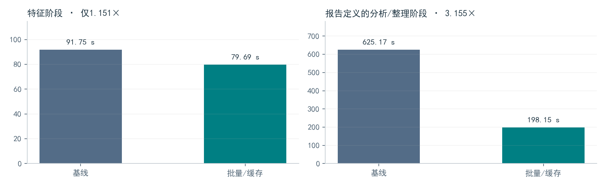

| 指标 | corrected baseline | 批量/缓存方案 | 比较 |
|---|---:|---:|---:|
| 特征阶段中位耗时 | 91.750 s | 79.689 s | 1.151×，下降13.15% |
| 特征阶段吞吐 | 2.180 图/s | 2.510 图/s | 未达既定提升门槛 |
| 分析/整理阶段中位耗时 | 625.165 s | 198.152 s | 3.155×，下降68.30% |
| 特征进程峰值RSS | 2253.0 MiB | 2490.6 MiB | 增长10.55% |
| 分析/整理进程峰值RSS | 3133.7 MiB | 3309.7 MiB | 增长5.62% |

原报告检查了图文向量一致性、缓存命中零前向、分析到整理缓存复用、决定与质量分一致性及资源约束。11个检查项中，`feature_speedup`未通过，因此正式性能状态保持`not_passed`。[S14]

## 测量边界与解释

分析/整理阶段的较大收益与避免重复编码、跨步骤复用有关；它不表示每个模型前向都提速3.155倍，也不能替代独立final test上的完整业务成本。实验使用共享RTX 3090，冷/热缓存、模型加载和其他进程负载影响必须依照原日志解释。

R@K、身份GT、偏好GT等正式质量数据仍不足，因此“输出决定一致”只是相对corrected baseline的行为一致，不是准确率证明。人脸TensorRT在仓库中有可选支持，但本次292图任务契约记录的是CUDAExecutionProvider；本报告没有把其耗时称为TensorRT性能。[S12]

<div class="callout">U2提速、解码优化与DALI按用户指示暂停。本报告只整理已有实验，没有恢复该工作，也没有以其他局部速度结果更改U2未通过的结论。</div>

<!-- PAGE: workflows | 19 真实整理与恢复验证 -->
# 从候选到导出，再到规范命名

真实流程以4个项目共200张图，执行分析→脚本复核/冲突→导出→重分析保护→整理。每项目16项检查，加6项跨项目检查，共70项；使用实际本地模型、隔离图库，`use_llm=false`。脚本复核用于验证行为，不新增人工标注。[S15][S16]

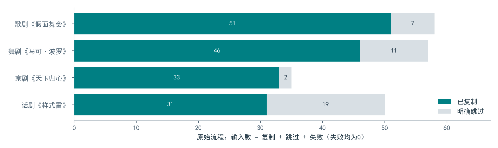

| 输入范围 | 输入 | 复制 | 明确跳过 | 失败 | 检查 |
|---|---:|---:|---:|---:|---:|
| 原始摄影文件名 | 200 | 161 | 39 | 0 | 70通过 |
| 已整理文件名再次处理 | 200 | 200 | 0 | 0 | 70通过 |

两种结果不是同一质量配额的算法横评。已整理序号需保持独立分组依据；不能因为普通目录中的名称相似，就把本已整理的不同序号重新误并为连拍。解析器修复同时保留日期、剧场和事项，当前项目未批准的旧幕次使用占位，不混入事项文本。

早期200图实验误用整理副本且命名范围不合格，原失败审计保留；后续分原始输入和已整理命名各自验证。该更正体现了“流程可跑通”和“输入范围符合规范”的区别。

## 四次服务恢复

292图人脸任务经历计划取消、首裁剪取消、首发布失败和重启完成，最终1095脸、453簇、0失败。17项检查验证不重复检测/裁剪/预览、每份文件只新建一次，并复用1份部分发布文件。源图、图库副本和受测源码摘要均按报告核查。[S12]

U8功能闭环已经有实测支持；正式U8仍缺U0—U3完整门槛、独立质量数据和受控端到端成本，状态保持`not_passed`。

<!-- PAGE: review | 20 质量复核与评测工具 -->
# 把“缺少真值”转化为可执行的数据任务

目前已经准备好两条人工复核路径：逐脸身份复核和双人事实/OCR复核。它们保留原图位置、固定观察内容和协议摘要，导出后由评测工具校验；不会自动应用到正式图库，也不自动锁定final test。

| 材料 | 规模 | 当前人工完成 | 指标状态 |
|---|---:|---:|---|
| 照片/来源划分复核 | 375项 | 未完成正式核验 | 场次/连拍/图库隔离待定 |
| 逐脸身份 | 1095脸，35身份可选 | 0 | B-cubed、已知召回、unknown FPIR为空 |
| 双人画面事实 | 100图，1352条 | 0 | 一致事实错误率为空 |
| 双人OCR转录 | 5图 | 0 | CER为空 |

## 逐脸决定约束

已知身份必须指向注册表中的ID；unknown与不可评价分开。镜像和重复检测例外单列。984张对齐裁剪直接复用既有PNG，111张使用历史检测框上下文裁剪，记录为未对齐；无新增检测。只有明确known、可评价且非例外的人脸进入当前B-cubed子集。[S17]

## 双人评测边界修复

工具要求A/B两份不同复核人草稿、相同协议和完整来源绑定，禁止修改图像摘要、事实陈述或OCR预测。每种任务内，相同原图字节不能通过不同条目ID重复计数；一张图片同时用于画面与OCR任务则允许。

新增测试先复现7个校验遗漏：协议、源图、事实、预测、槽位混用，以及视觉/OCR重复图内容。修复后15项测试通过；既有v2包由修正后的评测工具重新校验，页面与模型结果不重建。人工标签仍为0。[S18][S19]

## 质量材料与浏览器脚本的边界

17项事实浏览器检查证明分页、独立草稿、刷新、导出/恢复、OCR不预填及存储失败提示可用。脚本填入的临时决定不计作人工复核；姓名字段不同也不能单独证明两人独立审阅。真实质量工作还需要合格复核流程与分歧处理。

<!-- PAGE: gates | 21 局限、采用决策与研发建议 -->
# 下一阶段的重点是可信质量证据

| 阶段 | 已获得证据 | 尚缺关键条件 | 当前采用 |
|---|---|---|---|
| U0 数据/基准 | 去重清单、263/262标签、375复核材料 | 独立场次、近重复/图库隔离、final test | 保留开发集定位 |
| U1 身份 | 身份ID/角色契约、逐脸决策、1095脸复核包 | ≥200已知、≥300未知、≥10演员的隔离query与校准 | 正确性修复启用 |
| U2 性能 | 200图×5阶段比较、一致性检查 | 特征吞吐门槛与正式质量成本 | 未通过；暂停 |
| U3 可靠性 | 事务、任务恢复、HTTP和快照检查 | 受控整链路成本、远端权重证明 | 工程改动启用 |
| U4 幕次 | 262图、14变体、276项结果审计 | 8正文、新候选正例、演出版与独立测试 | SigLIP2默认 |
| U5 画面事实 | 实际图片请求、预算、OCR和复核工具 | 双人事实/参考转录、判定Macro-F1增益 | 按预算辅助 |
| U6/U7 分组 | 真实向量探索、万条规模检查 | 真实边界、身份例外、连拍偏好及新模型对照 | legacy默认 |
| U8 整链路 | 原始/已整理200图各70功能检查 | 必选阶段质量与性能门槛 | 正式未通过 |

## 建议的研发顺序

**首先补数据与复核。** 优先核对图库来源、已知/unknown人脸与相机时序；准备独立演出或剧目留出集。现有标签可支持迭代，但不能通过改文件名将已用开发图片变成final test。

**其次修复文本覆盖并做预声明比较。** 补足缺失场次正文和马可新增候选正例，核验演出版；冻结主指标、候选池和聚合方案，再评估模型替换。对样式雷等困难子集单列收益与退化。

**最后统一质量与成本决策。** 在用户恢复U2后，独立控制硬件负载、缓存、加载边界和重复次数；同时报告准确率、资源峰值、失败/降级与端到端时间，避免只选择好看的阶段指标。

已达到的工程收益应保留；Gemma、图聚类、窗口分段与连拍模型继续作为显式实验选项。当前证据不足以支持全自动演员/幕次标注或默认算法全面替换。

<!-- PAGE: reproducibility | 22 复现、代码与模型依据 -->
# 从图表回到冻结输入和原始报告

本报告的表格和统计图由`build_figures.py`直接读取原始JSON生成，完整数值另存`data/retrieval_metrics.csv`；`data/evidence_index.json`记录来源路径与SHA256。HTML内嵌所有图像，可离线阅读；PDF使用同一正文和样式排版。

## 只读复现入口

以下命令在仓库根目录执行，只验证已保存结果；需本地原始依赖文件齐全。它们不会重新调用模型，也不会覆写历史研究协议。

```bash
python outputs/reports/technical_report_20261024/build_figures.py
python outputs/reports/technical_report_20261024/build_report.py

# 使用项目Python环境执行已有数组审计
python outputs/acceptance/core_upgrade/\
u4_retrieval_study_262_gpu_retry_20261022/\
analyze_saved_results.py --verify-existing
```

前两条重建当前报告图表与HTML；PDF生成及分页检查使用报告目录中的渲染脚本。科学图表保留SVG和PNG两种版本，可独立用于后续汇报。正文可在`report_source.md`编辑；`technical_report.md`是展开数据表后的阅读版本。

## 关键实现位置

| 模块 | 代码位置（相对仓库根） |
|---|---|
| 人脸检测/对齐/表征 | `core_modules/face_recognition/` |
| 图文特征与Gemma适配 | `core_modules/image_search.py`、`organize/embedding_gemma.py` |
| 身份与角色 | `core_modules/organize/identity_registry.py` |
| 观察、预算、闭集判定 | `visual_evidence.py`、`scene_reasoner.py`、`llm_client.py` |
| 图与时序算法 | `face_graph_cluster.py`、`scene_change_points.py`、`temporal_burst.py` |
| 复核与恢复 | `review_store.py`、`review_queue.py`、`task_queue.py`及各任务实现 |
| 评测 | `tools/evaluate_face_identity_review.py`、`prepare_visual_fact_review.py` |

上表中未写前缀的算法文件均位于`core_modules/organize/`。本报告不将本地模型声明当成远端权重证明，也不引入尚未运行模型的公开benchmark数字。模型原理参考：ArcFace（CVPR 2019）；SigLIP/SigLIP2官方论文与big_vision实现；SCRFD/InsightFace官方实现；FAISS官方文档；Gemma本地模型卡、配置与SentenceTransformers接口；PaddleOCR官方实现。

<!-- PAGE: sources | 附录 证据索引 -->
# 实验来源与核验说明

下表是全文`[Sxx]`的来源。路径均相对`outputs/acceptance/core_upgrade/`；完整SHA256见随附JSON索引。大型向量、原始图片和任务数据库保留在本地实验目录，报告本身不包含所有原始数据。

| 编号 | 证据内容 | 报告文件 |
|---|---|---|
| <span id="S01">S01</span> | 照片清单与复核范围 | <span class="source-path">u0_partition_review_20261022/artifacts/summary.json</span> |
| <span id="S02">S02</span> | 262图检索比较与配对分析 | <span class="source-path">u4_retrieval_study_262_gpu_retry_20261022/summary.json</span> |
| <span id="S03">S03</span> | 冻结262图研究协议 | <span class="source-path">u4_retrieval_study_262_20261022/prepared/protocol.json</span> |
| <span id="S04">S04</span> | 短块实验硬件预检 | <span class="source-path">u4_text_blocks_20261022/preflight.json</span> |
| <span id="S05">S05</span> | 自动视觉预算100图 | <span class="source-path">u5_visual_budget_host_20261023/summary.json</span> |
| <span id="S06">S06</span> | 按需视觉观察100图 | <span class="source-path">u5_fact_observations_host_20261024/summary.json</span> |
| <span id="S07">S07</span> | 真实OCR五图 | <span class="source-path">u5_ocr_verified_20261023/summary.json</span> |
| <span id="S08">S08</span> | CPU万条特征规模检查 | <span class="source-path">u6_u7_cpu_scale_20261023/summary.json</span> |
| <span id="S09">S09</span> | 1095脸真实图聚类 | <span class="source-path">u7_graph_real_1095_20261023/summary.json</span> |
| <span id="S10">S10</span> | 262图时序/连拍探索 | <span class="source-path">u6_u7_temporal_real_20261023/summary.json</span> |
| <span id="S11">S11</span> | 292图真实任务HTTP响应 | <span class="source-path">u3_cluster_http_292_20261023/summary.json</span> |
| <span id="S12">S12</span> | 292图四次服务恢复 | <span class="source-path">u3_cluster_recovery_292_20261023/summary.json</span> |
| <span id="S13">S13</span> | 复核快照一万条记录 | <span class="source-path">u3_review_snapshot_scale_20261023/summary.json</span> |
| <span id="S14">S14</span> | U2两百图五次基准 | <span class="source-path">u2_publication_200x5_20261021/summary.json</span> |
| <span id="S15">S15</span> | 原始200图全流程 | <span class="source-path">u8_raw_workflow_200_20261023/summary.json</span> |
| <span id="S16">S16</span> | 已整理200图重处理 | <span class="source-path">u8_organized_reprocessing_200_host_20261023/summary.json</span> |
| <span id="S17">S17</span> | 1095脸待定评测 | <span class="source-path">u1_face_quality_pending_20261024/summary.json</span> |
| <span id="S18">S18</span> | 双人事实待定评测 | <span class="source-path">completion_audit_20261024/pending_fact_review.json</span> |
| <span id="S19">S19</span> | 最终文件与验证核查 | <span class="source-path">completion_audit_20261024/summary.json</span> |
| <span id="S20">S20</span> | 远端模型元数据 | <span class="source-path">remote_model_metadata_host_20261023/summary.json</span> |
| <span id="S21">S21</span> | U2实际执行环境 | <span class="source-path">u2_publication_200x5_20261021/batch.json</span> |

最终接续核查记录5647项检查、3365份唯一文件摘要匹配（包含582源文件和109图库文件），汇总6组107项既有通过测试，其中本轮新事实测试15项，其余沿用对应版本日志。检查数量不可当作独立质量样本量。[S19]

**报告版本**：2026-10-24 · 技术评审与研发版 · 代码`ad68c89`。图中舞台照片来自现有本地样本，仅为功能与场景说明，未按模型成功率挑选。浏览器图像来自既有验收过程；脚本草稿不计人工标注。正文、可视化和排版均在本地生成，撰写过程模型推理请求为0。

<!-- PAGE: references | 附录 方法参考与参数依据 -->
# 方法文献与本地实现依据

以下资料用于解释算法思想和接口；其中公开模型或论文的性能不被转引为本项目结果。实际参数以本地配置与各实验签名为准，尤其远端视觉服务无法由名称验证其权重。

| 参考 | 方法或实现依据 | 与本系统的关系 |
|---|---|---|
| R01 | Deng et al. *ArcFace: Additive Angular Margin Loss for Deep Face Recognition*. CVPR 2019. [论文](https://arxiv.org/abs/1801.07698) | 角度间隔训练目标；系统使用预训练向量推理 |
| R02 | *Sample and Computation Redistribution for Efficient Face Detection*. [论文](https://arxiv.org/abs/2105.04714)；[InsightFace SCRFD](https://github.com/deepinsight/insightface/tree/master/detection/scrfd) | 多尺度人脸框与关键点检测 |
| R03 | Zhai et al. *Sigmoid Loss for Language Image Pre-Training*. ICCV 2023. [论文](https://arxiv.org/abs/2303.15343) | 成对sigmoid图文匹配目标的基础 |
| R04 | [Google big_vision · SigLIP2](https://github.com/google-research/big_vision/blob/main/big_vision/configs/proj/image_text/README_siglip2.md) | SigLIP2编码器、模型配置与实现依据 |
| R05 | [FAISS](https://github.com/facebookresearch/faiss) | 归一化人脸向量的精确内积近邻搜索 |
| R06 | [SentenceTransformers](https://www.sbert.net/)与本地EmbeddingGemma 2配置 | Document前缀、多模态输入、均值池化与归一化 |
| R07 | [PaddleOCR](https://github.com/PaddlePaddle/PaddleOCR) | 图片文字检测与识别工具链 |

## 本地参数与协议的证据层次

1. **方法思想**：原模型论文与官方实现描述训练目标和结构，不代表本项目重新训练。
2. **本地适配**：SigLIP2配置、Gemma的`modules.json`、`1_Pooling/config.json`与提示配置决定实际编码方式。
3. **实验执行**：冻结源码、模型/预处理摘要、请求记录与向量数组决定某个结果的可复现范围。
4. **质量结论**：独立数据划分、可靠人工真值、预声明指标与受控实验决定能否采用新方案。

四层证据不可互相替代。例如CPU规模实验验证计算与内存范围，不能证明身份质量；实际HTTP请求证明视觉服务接受并处理图片，不能证明其权重与配置声明相同；开发集R@3改善也不能代替独立final test。

<div class="note">技术审查建议：优先检查S02的候选池与分母、S03的冻结协议、S12的执行契约、S14的计时范围，以及S17/S18中保持为空的质量指标。它们决定了当前实现可作出的最强结论。</div>
